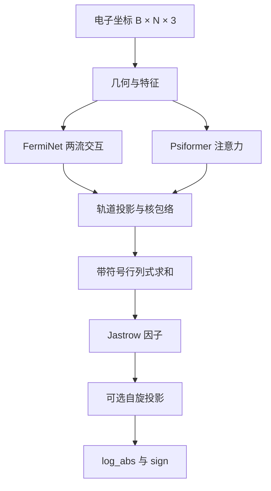

# FermiNet PyTorch 0.3.0：重构架构与迁移说明

更新日期：2026-10-22。本文描述已经实现的两轮破坏性重构，作为当前架构入口。旧版方案原文保存在[历史方案](ARCHITECTURE_REFACTORING_PROPOSAL_HISTORY.md)，其中旧接口、性能预期和生产评级不适用于当前版本。

## 完成范围

| 阶段 | 已实现内容 | 验收记录 |
|---|---|---|
| 第一轮，0.2.0 | 合并指数/Gaussian 包络；移除原型副本与适配器；整理运行库、测试、脚本和示例目录 | [第一轮报告](REFACTOR_PHASE1_REPORT.md) |
| 第二轮，0.3.0 | 统一两流交互层、波函数组装和训练更新；移除四组件包装与旧别名 | [第二轮报告](REFACTOR_PHASE2_REPORT.md) |

不维护旧接口。FermiNet 与 Psiformer 作为两种实际网络主干保留，共用物理因子、输出协议与训练核心。

第二轮统计范围包括原来的 `layers.py`、`layers_modern.py`、`model.py`、`composable_model.py`、`vmc_driver.py`、`train_vmc.py`，以及重构后新增的 `systems.py`：6 个核心文件的 1891 行变为 5 个文件的 863 行，减少 1028 行（54.4%）；排除文档字符串后的 Python 语句由 741 条变为 346 条。该统计不代表整个仓库缩减比例，也不能推导速度或显存收益。[原始统计](physics_evidence/phase2_structure.json)

## 包结构与职责

```text
ferminet_pytorch/     运行库，包内相对导入
tests/               正式实现的回归测试
scripts/             基准、诊断、严格 CUDA 验收和离线对照
examples/            可运行示例
physics_evidence/    原始日志、结果、源码哈希与历史源码快照
```

历史源码快照只供审计，不属于运行库，也不进入分发包。

| 模块 | 当前职责与边界 |
|---|---|
| `geometry.py`、`features.py` | 几何上下文与输入特征；特征距离平滑不改变物理库仑势 |
| `layers.py` | 唯一 `FermiInteractionLayer`；构造时固定自旋分区，池化排除电子自身 |
| `psiformer_attention.py` | Psiformer 注意力主干；仍有成对几何与注意力中间张量 |
| `envelope.py` | 唯一 `NuclearEnvelope`；指数与 Gaussian 使用同一个距离接口 |
| `model.py` | 唯一 `FermiNet`；选择主干，统一轨道与物理因子组装 |
| `determinants.py`、`jastrow.py`、`spin.py`、`physical_config.py` | 行列式及其导数、尖峰因子、自旋投影、物理配置校验 |
| `hamiltonian.py`、`kinetic_modern.py` | 体系、真实库仑势和局域动能；保留精确与随机迹后端 |
| `mcmc.py` | `MCMCSampler` 独占 walkers 和当前对数振幅缓存 |
| `loss.py` | 局域能量与参数代理损失的计算图隔离边界 |
| `vmc_driver.py` | `TrainingConfig`、`VMCDriver`、`train_vmc`；唯一优化更新核心 |
| `train_vmc.py`、`systems.py` | CLI 参数解析与分子体系构造 |
| `evaluation.py`、`vmc_statistics.py`、`physics_validation.py` | 冻结评估、相关采样统计与物理实验入口 |

## 波函数与交互层



通过 `interaction_type="ferminet"` 或 `"psiformer"` 选择主干。`forward_log_psi(r)` 返回 `(log_abs, sign)`；`model(r)` 返回形状为 `(B,)` 的波函数值。自旋投影需要在扩展、置换后的构型上重新构建几何。

`FermiInteractionLayer` 使用一个线性权重，按五组输入特征分别投影后相加，避免构造广播拼接特征。初始化时建立去除对角线的自旋池化矩阵，空自旋通道安全归零。

```python
from ferminet_pytorch.layers import FermiInteractionLayer

layer = FermiInteractionLayer(8, 4, 32, 8, n_up=2, n_down=1)
# h1: (B,3,8)，h2: (B,3,3,4)
h1_next, h2_next = layer(h1, h2)
```

核包络接收距离 `(B,N,M)`，返回 `(B,K,N,O)`，其中 K 为行列式数，O 为轨道数。模型负责坐标到距离的转换。静态池化矩阵占用空间，包络仍有五维广播中间量；当前没有零分配或固定加速比保证。

几何缓存只可在相同坐标对象、平滑规则及坐标梯度图内复用。冻结 dataclass 并不阻止其 tensor 被原地修改；调用方应将缓存和坐标按只读方式处理。

## 训练核心与状态归属

高层入口、直接 Driver 和训练实验脚本都调用 `VMCDriver.step`。Driver 管理优化状态；采样器独占构型和波函数缓存，二者必须共享同一模型及体系实例。

每步顺序为：

1. 必要时切换 Jastrow 训练阶段，并在恢复权重后刷新缓存。
2. 以 `adapt=False` 进行当前模型下的 MCMC 采样。
3. 在独立坐标图计算局域能量，将其 detach 后用于参数代理损失。
4. 为更新前测得的有限训练能量保存相应最佳参数快照。
5. 反向传播、梯度裁剪、优化更新、刷新采样缓存、推进调度器。

坐标导数与参数更新使用隔离的计算图，不把坐标拉普拉斯连接到参数损失，也不承诺整个训练步只有一次前向。默认 `clip_method="tanh"` 会改变梯度目标，不能称为严格无偏；可用 `"none"` 关闭能量截断。

```python
from ferminet_pytorch import FermiNet, TrainingConfig, train_vmc
from ferminet_pytorch.systems import build_h2_system

system = build_h2_system()
model = FermiNet(
    system.nuclear_coords, system.nuclear_charges, 1, 1,
    interaction_type="psiformer", use_cusp_jastrow=True, spin_adapted=True,
)
config = TrainingConfig(
    num_epochs=20, num_walkers=128, device="cpu",
    two_stage_jastrow=True, jastrow_stage1_epochs=10, jastrow_lr=1e-4,
)
result = train_vmc(system=system, model=model, config=config)
```

传入模型时，`interaction_type`、`use_cusp_jastrow` 等配置不会替换模型结构。两阶段训练仅在实际模型有 Jastrow 参数时启用：先冻结，后解冻并重建带独立学习率的 Adam 参数组与调度器。直接 Driver 的默认梯度裁剪阈值同样为 1；设 `grad_clip=0` 关闭。

`driver.run(n)` 再执行 n 步，并非运行到总步数 n。`driver.restore(state_dict)` 恢复模型权重并刷新缓存。checkpoint 区分更新后模型和更新前测量对应的最佳模型；优化器状态属于前者。后续 Kaggle 扩展增加了 schema-2 默认 Adam/余弦调度续训，支持训练阶段、walkers 和 Torch CPU/当前 CUDA RNG 恢复；适用限制与验证见 [Kaggle 训练指南](KAGGLE_T4_TRAINING_GUIDE.md)。

`result["final_energy"]` 为最后一个训练批次在更新前测得的能量，不一定属于返回时已恢复的最佳模型。训练最佳值不属于独立收敛证据；应另看 `eval_result`，并核验其诊断是否通过。

## 破坏性迁移清单

| 已移除的接口或路径 | 当前用法 |
|---|---|
| 顶层 `from model import FermiNet` 等导入 | `from ferminet_pytorch import FermiNet` 或包内模块导入 |
| `envelope_modern.NuclearEnvelopeModern`、适配器 | `ferminet_pytorch.envelope.NuclearEnvelope`；仅传距离 |
| `layers_modern.FermiInteractionLayerModern` | `layers.FermiInteractionLayer`；自旋数移到构造函数，前向只传两流特征 |
| `ComposableFermiNet` 与独立 Psiformer 模型组装 | `FermiNet(interaction_type=...)`；符号/对数输出显式调用 `forward_log_psi` |
| `OrbitalEnvelopeProjector`、`BranchlessCofactorDeterminant` 门面 | 轨道组装由模型负责；行列式内核在 `determinants.py` |
| `VariationalState`、`HamiltonianComposite`、额外 `MetropolisSampler` | `VMCDriver(model, system, sampler, ...)`，采样使用 `MCMCSampler` |
| `train_vmc(num_epochs=..., ...)`、`train_two_stage_jastrow` | `train_vmc(system=..., model=..., config=TrainingConfig(...))` |
| 从 CLI 模块导入体系构造或统计辅助函数 | 体系使用 `systems.py`，评估使用 `evaluation.py`，统计使用 `vmc_statistics.py` |
| `MetropolisHastings`、`SpinProjectedWaveFunction`、`vmc_loss` 旧别名 | 使用 `MCMCSampler`、模型的自旋投影选项、`vmc_surrogate_loss` |
| 根目录脚本及 `test_*.py` | 以 `python -m examples...`、`python -m scripts...`、`unittest discover -s tests -t .` 运行 |

旧 checkpoint 不提供自动兼容加载。离线[数值对照脚本](scripts/verify_phase2_refactor.py)中存在受限的参数映射，仅用于保存源码与当前模型的审计，不能当作通用迁移器。相同随机种子重新初始化也不保证旧、新模型逐位一致。

## 物理约束与证据范围

模型改动应核验同自旋反对称性、目标自旋投影、完整波函数的尖峰行为及非节点聚并极限。核与异自旋 s-wave 尖峰涉及球平均；同自旋 `1/4` 是去掉 p-wave 零点后的径向系数。物理库仑距离不通过平滑或截断伪造有限能量，精确节点处 `HΨ/Ψ` 未定义。

| 证据 | 已记录结果 | 适用边界 |
|---|---|---|
| [严格 CUDA 完整验收](physics_evidence/phase2_cuda_complete/summary.json) | 251 通过，0 失败，0 错误，0 跳过；83.90 秒；RTX 3060 Laptop GPU，PyTorch 2.14.0，CUDA runtime 13.0 | 套件同时包含 CPU 与真实 CUDA 检查，不表示 251 项全部在 GPU 执行 |
| [旧、新模型独立对照](physics_evidence/phase2_equivalence.json) | 三种旧组装 × 三组自旋，共 9 组 float64 对照；全部满足 `atol=rtol=1e-8` | 固定权重和构型；参数梯度仅比较选定轨道权重 |
| [对照最大差异](physics_evidence/phase2_structure.json) | 对数波函数 7.47e-14，坐标梯度 2.95e-12，局域能量 5.92e-12 Ha，选定参数梯度 5.19e-11；符号一致 | 数值向上取整，不是全空间误差上界 |
| 独立物理与数学回归 | 解析体系、反对称性、自旋、尖峰、奇异行列式导数、JVP 等检查见[第二轮验收](REFACTOR_PHASE2_REPORT.md) | 测试通过不等于所有分子、参数和极限的数学证明 |
| 冻结评估与历史训练 | 评估保留时间/链结构并报告混合诊断、ESS、分块和不确定度，见[物理证据报告](PHYSICS_CORRECTNESS_REPORT.md) | 第二轮未新增长期收敛实验，未证明统一模型达到普遍化学精度 |

原始日志、源码哈希和失败后重跑记录保留在证据目录。历史报告中的 Level 5、固定加速比和短训练化学精度结论，不属于当前验收结果。

## 复现入口与后续工作

在仓库根目录运行：

```powershell
uv sync --locked
uv run python -m examples.example_h2
uv run python -m ferminet_pytorch.train_vmc --device cpu --epochs 5 --walkers 64
uv run python -m unittest discover -s tests -t . -v
F:\conda\envs\torch\python.exe -m scripts.run_cuda_tests
uv run python -m scripts.verify_phase2_refactor
uv build
```

CPU 环境会按环境跳过 CUDA 检查；严格 CUDA 入口要求 GPU 可用，并将任意 skip 作为失败。离线对照依赖本工作区保存的 `physics_evidence/phase2_baseline/`，分发包不包含该快照。Windows 编译器导入出现 GBK 解码错误时，先设置 `$env:PYTHONUTF8='1'`。

第二轮重构完成时，长期收敛、受控性能基准与随机链续训尚未验收。后续 Kaggle 工作已补充续训及其回归，并提供多种子长期实验入口，进度与适用限制见 [Kaggle 训练指南](KAGGLE_T4_TRAINING_GUIDE.md)；入口可用不代表长期实验已完成或已达到化学精度。

实际使用见 [README](README.md)，扩展与底层调用见[开发指南](DEVELOPER_GUIDE.md)，逐项验证见[第二轮报告](REFACTOR_PHASE2_REPORT.md)。
