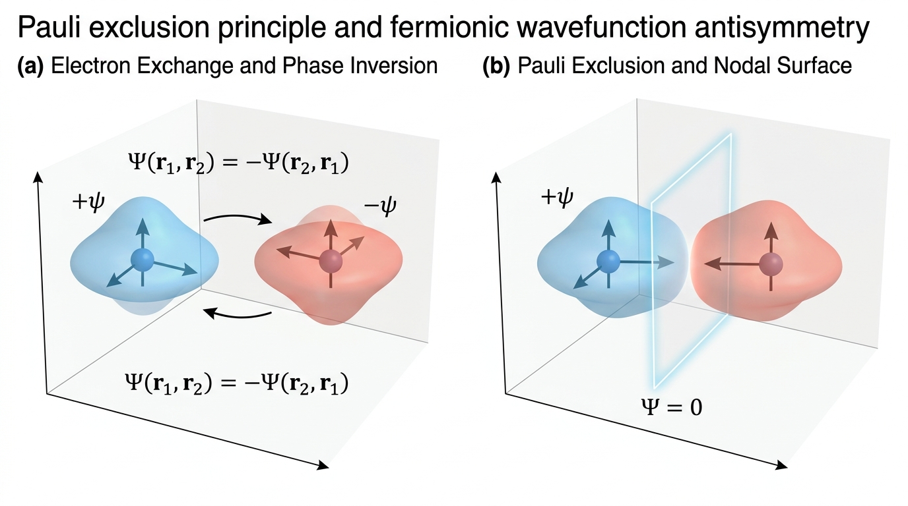
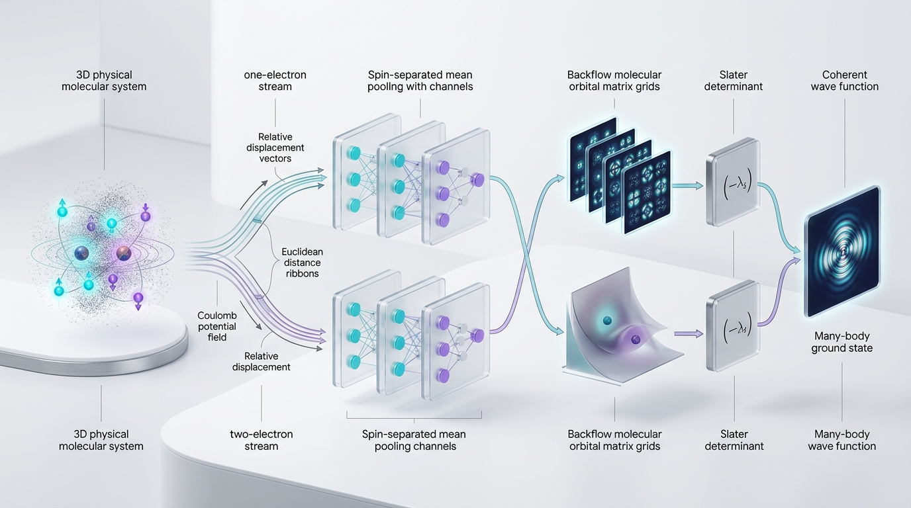
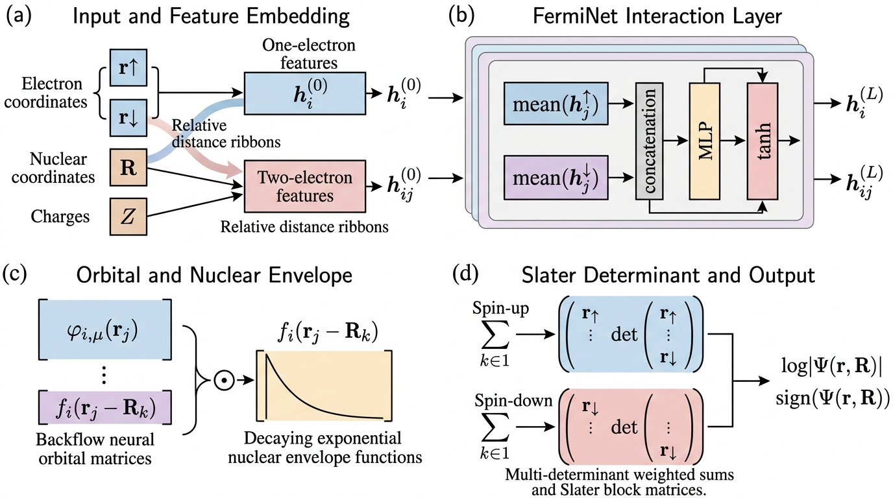

> **物理与精度说明（2026-10-22）**：Jastrow 自身有正确斜率不等于完整模型自动满足尖峰；网络特征、包络与自旋必须相容。同自旋的 `1/4` 指去掉线性节点后的径向系数，其他尖峰涉及相应球平均。精确节点处局域能量未定义。样本能量接近参考值还需要误差条和混合诊断支持；详见 [物理正确性报告](PHYSICS_CORRECTNESS_REPORT.md)。

# FermiNet 从零到一：量子化学深度学习新手入门与实战宝典 (Zero to One Guide)

> **导读**：
> 如果你是一名计算机科学、人工智能或软件工程背景的同学，面对“量子力学”、“薛定谔方程”、“Slater 行列式”、“变分量子蒙特卡洛”这些看似高深晦涩的物理学名词，常常会望而却步。
> 
> **请放心！** 编写这份文档的目的，就是为了**彻底打破物理与人工智能之间的专业壁垒**。我们将抛弃枯燥难懂的物理教科书黑话，用程序员最容易理解的直白语言、生动的直觉比喻、清晰的 ASCII 架构图和可运行的代码，带你从零看懂 FermiNet（费米神经网络）是如何用深度学习破解量子化学世纪难题的！
>
> 🧭 **全景文档导航**：
> - 🔰 **当前文档**：适合物理小白、深度学习初学者快速建立直觉与运行基础案例。
> - 🛠️ [**开发指南**](DEVELOPER_GUIDE.md)：统一交互层、模型、训练核心的当前调用方式与扩展边界。
> - 🧭 [**0.3.0 重构架构与迁移清单**](ARCHITECTURE_REDUNDANCY_REVIEW_AND_REFACTORING_PROPOSAL.md)：已完成的重构、旧接口替换方式和验收证据范围。
> - 📊 [**生产就绪度评估与性能 Benchmark 报告 (EVAL_REPORT.md)**](FERMINET_REFACTORING_EVALUATION_AND_PRODUCTION_READINESS_REPORT.md)：查阅 21 项架构冗余消除细节、双环境 246 项测试审计与加速比对比。

---

## 目录 (Table of Contents)

1. [💡 写在前面：为什么用神经网络算量子力学？](#1-写在前面为什么用神经网络算量子力学)
2. [⚛️ 第一章：量子力学与量子化学极简极速前置](#2-第一章量子力学与量子化学极简极速前置)
   - 2.1 什么是薛定谔方程？微观世界的“牛顿第二定律”
   - 2.2 为什么电子多了解不出解析解？可怕的“指数墙”
   - 2.3 什么是电子波函数 $\Psi(r)$ 与玻恩几率解释 $|\Psi|^2$？
   - 2.4 费米子置换反对称性与泡利不相容原理：“撞衫即毁灭”
   - 2.5 传统化学方法是怎么做的？Hartree-Fock 与 Slater 行列式的局限
   - 2.6 FermiNet 深度学习 Backflow 机制做了什么突破？
   - 2.7 自旋污染 (Spin Contamination) 与自旋纯态投影算符的物理本质
   - 2.8 Kato 尖峰条件 (Kato Cusp Conditions)：粒子碰撞点处的微观奇异性与动能抵消
3. [🧠 第二章：FermiNet 神经网络核心架构超清晰拆解](#3-第二章ferminet-神经网络核心架构超清晰拆解)
   - 3.1 [整体架构全景数据流 (学术期刊规范架构图)](#31-整体架构全景数据流-学术期刊规范架构图)
   - 3.2 几何特征提取 (`features.py`)：相对位移、距离、平滑无尖峰特征与核电荷注入
   - 3.3 自旋分流交互层 (`layers.py`)：单/双电子流与自旋分离池化
   - 3.4 原子核包络衰减模块 (`envelope.py`)：物理渐近条件与 soft-exponential 包络
   - 3.5 反对称波函数构建 (`model.py`)：Backflow 轨道矩阵构造
   - 3.6 数值稳定性基石：`torch.linalg.slogdet` 与 LogSumExp 技巧
   - 3.7 Kato 尖峰解析 Jastrow 因子模块 (`jastrow.py`) 深入剖析
   - 3.8 自旋纯态投影算符模块 (`spin.py`) 深入剖析与 Signed LogSumExp 算法
4. [🎲 第三章：变分量子蒙特卡洛 (VMC) 极简教程](#4-第三章变分量子蒙特卡洛-vmc-极简教程)
   - 4.1 为什么高维积分必须用 MCMC 随机游走采样？
   - 4.2 Metropolis-Hastings 接受/拒绝机制
   - 4.3 什么是局域能量 $E_L(r)$？动能与势能的精妙平衡
   - 4.4 变分原理：为什么能量越低越逼近真理？
   - 4.5 核心物理公式纠偏：有限批次协方差代理损失与求导真相
   - 4.6 局域能量平滑截断 (Umrigar Tanh Clipping)：防止优化器“炸飞”
5. [🗺️ 第四章：阶段核心演进与模块全景导览](#5-第四章阶段-012-核心演进与模块全景导览)
   - 5.1 核心源码文件与职责对照表
   - 5.2 局域动能拉普拉斯自动微分求解机制
6. [🚀 第五章：5 分钟上手极速实操 (含输出物理指标通俗解读)](#6-第五章5-分钟上手极速实操-含输出物理指标通俗解读)
   - 6.1 演示 1：氢分子 $H_2$ 基础波函数推断与局域能量 (`example_h2.py`)
   - 6.2 演示 2：氢分子 $H_2$ 端到端 VMC 变分训练 (`train_vmc.py`)
   - 6.3 演示 3：极性异核分子氢化锂 $LiH$ 变分优化
   - 6.4 演示 4：Kato 尖峰库仑奇异性诊断与动势能抵消验证 (`diagnose_cusp_divergence`)
   - 6.5 演示 5：现代化解耦 API 实操 (`TrainingConfig` + `train_vmc`)
   - 6.6 训练输出物理指标白话对照表
7. [❓ 第六章：新手高频问答 FAQ](#7-第六章新手高频问答-faq)
   - Q1: 为什么波函数的对数值 `log|Psi|` 经常是负几百？
   - Q2: 什么是 Hartree 原子单位制？怎么换算成熟悉的单位？
   - Q3: 为什么 100 电子大体系强烈推荐使用 double (`float64`) 精度？
   - Q4: 为什么 MCMC 接受率最好在 50% 附近？
   - Q5: 为什么训练时能量方差 `Var(E)` 会越来越小？(神奇的零方差原理)
   - Q6: 为什么有了 Slater 行列式，还需要额外的自旋投影？(自旋污染的危害)
   - Q7: 为什么引入 Kato 尖峰 Jastrow 因子能显著加快 VMC 收敛？

---

## 1. 💡 写在前面：为什么用神经网络算量子力学？

在经典物理学中，要预测行星轨道或小球弹跳，我们用牛顿力学公式 $F = ma$。输入初始位置和速度，就能精准计算未来轨迹。

但在微观分子世界里，电子小到必须遵循量子力学规律。量子力学之父之一狄拉克 (Paul Dirac) 曾在 1929 年感叹：
> *"解释绝大部分物理学和全部化学所必需的底层物理定律已完全为人所知，唯一的困难是这些定律对应的数学方程太过复杂，以至于根本无法求解。"*

在过去近百年里，化学家们发明了各种经验公式、近似算法（如密度泛函理论 DFT、耦合簇理论 CCSD(T) 等），但往往在“计算速度快”和“化学精度准”之间左右为难。

2020 年，DeepMind 团队发表了 **FermiNet (Fermi Neural Network)**。该方法用神经网络参数化多电子试探波函数，并结合变分量子蒙特卡洛进行优化。
它以电子—核几何和库仑相互作用为输入先验；不同实现的精度取决于 Hamiltonian、网络、采样、优化和误差统计。本仓库是研究型 PyTorch 实现，不自动继承论文结果。

本仓库提供模块化代码，用于复现实验链路并探索这一类架构；它不等同于官方实现或论文级复现。

---

## 2. ⚛️ 第一章：量子力学与量子化学极简极速前置

### 2.1 什么是薛定谔方程？微观世界的“牛顿第二定律”

对于一个包含 $M$ 个原子核、$N$ 个电子的分子体系（在玻恩-奥本海默近似下，原子核质量远大于电子，假定核静止），电子运动由**定态非相对论薛定谔方程 (Schrödinger Equation)** 支配：

$$\hat{H} \Psi = E \Psi$$

别被希腊字母吓到了，我们用程序员的面向对象思维来理解它：
- $\Psi$（Psi，波函数）：可以看作**存储系统状态的黑盒对象**，输入所有电子的空间坐标 $r$，输出一个物理几率振幅标量。
- $\hat{H}$（哈密顿算符，Hamiltonian）：可以看作一个**处理函数/操作符**，负责计算系统包含的总能量操作（动能 + 势能）。
- $E$（能量本征值）：是一个具体的数值（标量），代表体系在特定状态下的总能量。

这个方程本质上就是一个**高阶微分方程的特征值问题**：寻找一个波函数 $\Psi$，让算符 $\hat{H}$ 作用在它身上后，结果刚好等于一个常数 $E$ 乘以它自己！
化学家最关心的往往是**基态 (Ground State)**，也就是能量最低的稳定态 $E_0$。

### 2.2 为什么电子多了解不出解析解？可怕的“指数墙”

- **氢原子 (1 个质子 + 1 个电子)**：初中/高中物理学过，有完美漂亮的解析解（球谐函数、轨道）。
- **氦原子 (2 个电子) 及以上**：**彻底解不出解析解！**

为什么？因为电子带负电，电子与电子之间存在库仑相互排斥项 $\frac{1}{\|r_i - r_j\|}$！
这种多体相互作用让变量彻底耦合在了一起，无法做数学上的“变量分离”。

在数值计算上，如果有 $N$ 个电子，每个电子有 3 维笛卡尔坐标 $(x, y, z)$，整个波函数定义在 **$3N$ 维空间**中：
- 比如只有 10 个电子的简单分子，输入空间就是 $3 \times 10 = 30$ 维！
- 如果像传统网格离散化方法那样，每个维度只采样 10 个网格点，总共就需要 $10^{30}$ 个采样点！
- 全球所有超级计算机加起来也存不下一个分子的网格——这就是臭名昭著的**维度灾难 (Curse of Dimensionality)**。

### 2.3 什么是电子波函数 $\Psi(r)$ 与玻恩几率解释 $|\Psi|^2$？

在宏观世界，我们可以指着屏幕说“小球就在坐标 $(x, y, z)$ 处”。
但在量子力学中，海森堡不确定性原理告诉我们：**你无法同时精确获知电子的位置与动量。**

物理学家玻恩 (Max Born) 提出了伟大的几率解释：
- 波函数 $\Psi(r_1, r_2, \dots, r_N)$ 本身是一个空间幅值（甚至可以带正负号）；
- 它的**模平方 $|\Psi(r_1, r_2, \dots, r_N)|^2$** 代表所有电子同时出现在这些位置的**联合概率密度**！

$$\text{电子出现在空间微元 } dr \text{ 的概率} = \frac{|\Psi(r)|^2}{\int |\Psi(r')|^2 dr'} dr$$

波函数模方越大的地方，电子“喜欢”待在那里的概率就越高；波函数为 0 的地方（称为“节点面”，Nodal Surface），电子绝对不会出现！

### 2.4 费米子置换反对称性与泡利不相容原理：“撞衫即毁灭”

电子是一种**全同费米子 (Fermions)**。微观世界没有编号，所有的电子长得一模一样。
量子力学给费米子规定了一条铁律：**波函数必须关于同自旋电子置换具有严格的反对称性 (Antisymmetry)**。

换句话说，如果你交换任意两个同自旋电子 $i$ 和 $j$ 的坐标，波函数的绝对值完全不变，但**符号必须反号**：

$$\Psi(\dots, r_i, \dots, r_j, \dots) = - \Psi(\dots, r_j, \dots, r_i, \dots)$$

这个看似简单的负号，引出了化学中最重要的基石——**泡利不相容原理 (Pauli Exclusion Principle)**：
如果两个同自旋电子试图挤在完全相同的位置，即令 $r_i = r_j$：
$$\Psi(\dots, r_i, \dots, r_i, \dots) = - \Psi(\dots, r_i, \dots, r_i, \dots) \implies \Psi = -\Psi \implies \Psi = 0!$$
波函数直接等于 0，意味着两个同自旋电子处于相同位置的概率为 $|\Psi|^2 = 0$——它们绝对不可能占据完全相同的空间位置！这也是为什么物质不会坍缩、原子具有丰富化学性质的终极物理原因。

<p align="center">
  
  <br>
  <em>图 2-1 | 泡利不相容原理与费米子波函数反对称性学术图解。(a) 同自旋电子空间坐标置换引发波函数正负相位反转 $\Psi(\mathbf{r}_1, \mathbf{r}_2) = -\Psi(\mathbf{r}_2, \mathbf{r}_1)$；(b) 两个同自旋电子相互靠近时中间自发形成的节点面（Nodal Surface, $\Psi = 0$），严格阻止电子重合。</em>
</p>

### 2.5 传统化学方法是怎么做的？Hartree-Fock 与 Slater 行列式的局限

数学上，什么样的结构天然满足“交换两行/两列就变号，有两行相同就等于 0”？
答案是：**线性代数中的矩阵行列式 (Determinant)！**

20 世纪物理学家约翰·斯莱特 (John C. Slater) 提出了著名的 **Slater 行列式**：
构造一个 $N \times N$ 矩阵，矩阵第 $i$ 行第 $j$ 列填入“第 $i$ 个电子在第 $j$ 个固定单电子轨道 $\phi_j(r_i)$ 上的值”：

$$D = \begin{bmatrix}
\phi_1(r_1) & \phi_2(r_1) & \dots & \phi_N(r_1) \\
\phi_1(r_2) & \phi_2(r_2) & \dots & \phi_N(r_2) \\
\vdots & \vdots & \ddots & \vdots \\
\phi_1(r_N) & \phi_2(r_N) & \dots & \phi_N(r_N)
\end{bmatrix}, \quad \Psi = \det(D)$$

根据行列式的性质：
1. 交换两行（相当于交换两个电子的位置），行列式自动变号 $\det \to -\det$；
2. 如果两个电子坐标相同 $r_1 = r_2$，两行完全相同，行列式恒等于 0。

**传统量子化学的致命短板：**
在经典的 Hartree-Fock (HF) 方法中，轨道 $\phi_j(r_i)$ **仅仅依赖单电子坐标 $r_i$**！
这相当于假定每个电子只感受到其他所有电子的“平均电场”（平均场近似，Mean-field approximation），**完全忽略了两个电子瞬时相互躲避的“动态关联 (Electron Correlation)”**。
为了弥补这个缺陷，传统化学需要把成千上万、甚至数百万个不同的 Slater 行列式线性组合叠加起来（如多组态 CISD, CASSCF 等），计算量呈现指数级爆炸！

### 2.6 FermiNet 深度学习 Backflow 机制做了什么突破？

既然传统轨道 $\phi_j(r_i)$ 只看单电子太简陋，能不能让轨道**同时感知到周围其他所有电子的位置**？
这就是物理学中经典的 **Backflow（回流）思想**：
$$\phi_j(r_i; \{r_{\setminus i}\})$$
每个轨道既是电子 $i$ 的函数，又动态依赖所有其他电子 $\{r_{\setminus i}\}$ 的瞬时排布！

但人工设计复杂的 Backflow 函数极其困难。DeepMind 提出的 **FermiNet** 做出了革命性突破：
**用多层前馈神经网络直接充当 Backflow 映射！**
- 神经网络输入所有电子和原子核的相对空间几何；
- 经过自旋分流的图式交互更新，让电子之间充分“对话”与“避让”；
- 输出动态的广义轨道，再送入 Slater 行列式！

这样可以用较少的行列式表达复杂的多电子节点结构；是否达到化学精度必须由统一基准、参考体系和多种子误差统计验证，不能由架构本身保证。

### 2.7 自旋污染 (Spin Contamination) 与自旋纯态投影算符的物理本质

初学者常常会问：**既然 Slater 行列式已经满足了费米子的反对称性，为什么我们还需要额外的自旋处理？**

这涉及量子力学中另一个极其重要、却经常被深度学习工程师忽视的概念——**总自旋算符 $\hat{S}^2$ 的本征态约束与自旋污染**。

#### 1. 什么是自旋污染？
在非相对论量子化学中，分子的非简并哈密顿量 $\hat{H}$ 不仅与总自旋 $z$ 方向分量 $\hat{S}_z$ 对易，还与总自旋角动量算符 $\hat{S}^2$ **严格对易**：
$$[\hat{H}, \hat{S}^2] = 0, \quad [\hat{H}, \hat{S}_z] = 0$$
这意味着分子的真实物理定态必须**同时是 $\hat{S}^2$ 和 $\hat{S}_z$ 的共同本征态**，满足：
$$\hat{S}^2 \Psi = S(S+1) \hbar^2 \Psi, \quad \hat{S}_z \Psi = M_S \hbar \Psi$$
- 对于双电子单重态（Singlet，如氢分子 $H_2$ 基态、闭壳层分子），总自旋量子数必须严格满足 $S=0$，此时 $\hat{S}^2$ 期望值必须精确等于 $0$；
- 对于双电子三重态（Triplet，如激发态或氧气分子），总自旋量子数 $S=1$，$\hat{S}^2$ 期望值精确等于 $1(1+1) = 2$。

#### 2. FermiNet 基础结构为什么会破坏纯自旋态？
在标准 FermiNet 中，波函数是由自旋向上块和自旋向下块各自的 Slater 行列式乘积构成的：
$$\Psi_{\text{base}}(r_1, \dots, r_N) = \det(D^\uparrow) \times \det(D^\downarrow)$$
这个乘积虽然严格固定了电子数差值（从而固定了自旋投影 $M_S = \frac{n_\uparrow - n_\downarrow}{2}$），但**它根本不是 $\hat{S}^2$ 的本征态！**
由于神经网络的 Backflow 轨道权重是自由可学的非线性函数，在没有额外约束时，输出的波函数往往是单重态 ($S=0$)、三重态 ($S=1$) 乃至更高自旋态的**非物理杂糅混合体**！这种物理伪态被称为**自旋污染 (Spin Contamination)**。
自旋污染会破坏体系的变分上界一致性，引入非物理能量漂移，使得势能面断裂、自旋多重度计算失准。

#### 3. 破局之道：自旋纯态空间置换投影算符 (`spin.py`)
对于包含 1 个自旋向上电子和 1 个自旋向下电子的双电子单重态（如 $H_2$），全波函数包含空间部分和自旋部分：
$$\Psi(\mathbf{r}_1 \sigma_1, \mathbf{r}_2 \sigma_2) = \Psi_{\text{spatial}}(\mathbf{r}_1, \mathbf{r}_2) \times \frac{1}{\sqrt{2}}(\alpha_1 \beta_2 - \beta_1 \alpha_2)$$
因为自旋单重态基底 $(\alpha \beta - \beta \alpha)$ 本身关于电子置换是**反对称**的，为了让全波函数关于两电子完全反对称（费米子统计律），其**空间波函数 $\Psi_{\text{spatial}}(\mathbf{r}_1, \mathbf{r}_2)$ 必须关于两电子空间坐标完全对称**：
$$\Psi_{\text{spatial}}(\mathbf{r}_1, \mathbf{r}_2) = \Psi_{\text{spatial}}(\mathbf{r}_2, \mathbf{r}_1)$$

因此，消除自旋污染的最直接、最干净的数学方法，就是在神经网络输出前施加**空间对称化投影算符**：
$$\hat{P}_{S=0} \Psi(\mathbf{r}_1, \mathbf{r}_2) = \frac{1}{2} \left[ \Psi(\mathbf{r}_1, \mathbf{r}_2) + \Psi(\mathbf{r}_2, \mathbf{r}_1) \right]$$
同理，对于双电子三重态 ($S=1, M_S=0$)，空间波函数必须严格反对称：
$$\hat{P}_{S=1} \Psi(\mathbf{r}_1, \mathbf{r}_2) = \frac{1}{2} \left[ \Psi(\mathbf{r}_1, \mathbf{r}_2) - \Psi(\mathbf{r}_2, \mathbf{r}_1) \right]$$
本项目实现的 `SpinProjector`（在 `spin.py` 中）原生封装了这一投影算符，配合带符号 Signed LogSumExp 保证全精度数值稳定，从第一性原理上将自旋污染降低为精确的数学零！

---

### 2.8 Kato 尖峰条件 (Kato Cusp Conditions)：粒子碰撞点处的微观奇异性与动能抵消

在量子化学求解中，另一个经典理论高地就是著名的 **Kato 尖峰边界条件 (Kato Cusp Conditions)**。

#### 1. 库仑势能在粒子重合处的物理灾难
回顾分子体系的库仑相互作用势能：
$$V(r) = -\sum_{i, I} \frac{Z_I}{\|\mathbf{r}_i - \mathbf{R}_I\|} + \sum_{i < j} \frac{1}{\|\mathbf{r}_i - \mathbf{r}_j\|} + V_{nn}$$
注意分母上的欧氏距离：
- 当第 $i$ 个电子飞到原子核处重合时（$\|\mathbf{r}_i - \mathbf{R}_I\| \to 0$），吸引势能 $V \to -\infty$！
- 当任意两个电子彼此碰撞重合时（$\|\mathbf{r}_i - \mathbf{r}_j\| \to 0$），排斥势能 $V \to +\infty$！

#### 2. 局部能量为什么必须处处有限？
真实世界的薛定谔方程本征态满足 $\hat{H}\Psi = E\Psi$，也就是说在波函数非零的点，**局部能量 $E_L(r) = T_L(r) + V(r)$ 都必须是一个有限的常数 $E$**！
如果势能 $V(r)$ 奔向 $\pm \infty$，那么**局域动能项 $T_L(r) = -\frac{1}{2}\left(\nabla^2 \ln|\Psi| + |\nabla \ln|\Psi||^2\right)$ 必须在粒子碰撞点以完全相同的发散速率、完全相反的符号精确奔向 $\mp \infty$**，把势能发散**完美对消抵消掉**！

#### 3. 数学大师 Kato 的精确导数极限定理
数学物理大师 Tosio Kato 在 1957 年严格证明：为了让波函数的拉普拉斯算子在原点产生反向发散抵消库仑奇点，波函数的对数梯度在粒子碰撞点必须满足一组**严格的渐近斜率常数**：
1. **电子-核碰撞点** ($r_{iI} = \|\mathbf{r}_i - \mathbf{R}_I\| \to 0$)：
   $$\left. \frac{\partial \ln|\Psi|}{\partial r_{iI}} \right|_{r_{iI} \to 0} = -Z_I$$
   即波函数在原子核附近呈现一个尖锐的“帐篷尖角”（Cusp，斜率为负的核电荷数）。
2. **异自旋电子碰撞点** ($r_{ij} = \|\mathbf{r}_i - \mathbf{r}_j\| \to 0$, 反平行自旋)：
   $$\left. \frac{\partial \ln|\Psi|}{\partial r_{ij}} \right|_{r_{ij} \to 0} = \frac{1}{2}$$
3. **同自旋电子碰撞点** ($r_{ij} \to 0$, 平行自旋，泡利不相容点)：
   $$\left. \frac{\partial \ln|\Psi|}{\partial r_{ij}} \right|_{r_{ij} \to 0} = \frac{1}{4}$$

#### 4. 纯神经网络拟合尖峰的困境与显式 Jastrow 因子解题法
神经网络通常由连续平滑的激活函数（如 $\tanh$、$\text{SiLU}$）搭建。在原点处，光滑函数的导数连续，拉普拉斯算子是平滑的实数，**根本无法自然拟合这种带有不可导导数跳变的尖点奇点**！
如果强迫神经网络去硬拟合尖峰：
- 采样粒子稍微靠近原子核或另一个电子，势能骤降到几千几万，动能无法及时抵消，局域能量 $E_L$ 产生极其恐怖的离群震荡；
- 变分优化器为了修补这个奇异点，频繁产生极度畸变的梯度更新，导致训练极难收敛、能量方差居高不下。

**解析 Jastrow 因子的破局：**
在波函数外显式乘以一个严格满足 Kato 尖峰条件的解析因子 $J(r) = \exp(U_{en} + U_{ee})$：
$$U_{en} = -\sum_{i, I} \frac{Z_I r_{iI}}{1 + b_{en, I} r_{iI}}, \quad U_{ee} = \sum_{i < j} \frac{\gamma_{ij} r_{ij}}{1 + b_{ee, ij} r_{ij}}$$
- 在短程 $r \to 0$ 时，$\frac{\partial U}{\partial r}$ 精确等于 $-Z_I$、$\frac{1}{2}$ 和 $\frac{1}{4}$，**瞬间完美消解库仑发散**；
- 在长程 $r \to \infty$ 时，Padé 分母迅速阻尼饱和，不破坏波函数的远距离渐近衰减；
- 神经网络彻底卸下了拟合剧烈奇点的包袱，只需专注于用 Backflow 表征平滑的多体电子关联！

---

## 3. 🧠 第二章：FermiNet 神经网络核心架构超清晰拆解

<p align="center">
  
</p>

### 3.1 整体架构全景数据流 (学术期刊规范架构图)

<p align="center">
  
</p>

下面是对应的文本级数据流水线与张量传递概览，请在阅读后续章节时随时对照：

```text
               ┌─────────────────────────────────────────────────────────────┐
               │                电子三维空间坐标 r: (B, N, 3)                │
               │               原子核坐标与电荷 R, Z: (M, 3), (M,)           │
               └──────────────────────────────┬──────────────────────────────┘
                                              │
                      【几何特征嵌入 ElectronFeatureEmbedding features.py】
                           (可选平滑无尖峰特征: d^2 / (1 + d))
                                              │
               ┌──────────────────────────────┴──────────────────────────────┐
               │ 单电子流特征 h1: (B, N, 5M)   │ 双电子流特征 h2: (B, N, N, 4) │
               │   [r_{iI}, d_{iI}, Z_I]       │   [r_{ij}, d_{ij}]            │
               └──────────────────────┬───────┴──────────────┬───────────────┘
                                      │                      │
                        【自旋分流交互层 FermiInteractionLayer layers.py】
                        (L 层循环：同自旋/异自旋分离均值池化 + 残差连接)
                                      │                      │
                                      ▼                      ▼
               ┌─────────────────────────────────────────────────────────────┐
               │    高阶单电子隐藏表征: h1_final (B, N, hidden_dim_one)       │
               └──────────────────────┬──────────────────────┬───────────────┘
                                      │                      │
                         (切片前 n_up 个电子)   (切片后 n_down 个电子)
                                      │                      │
                      ┌────────────────┴────┐            ┌────┴────────────────┐
                      │ 自旋向上分支 (Up)   │            │ 自旋向下分支 (Down) │
                      └────────┬────────────┘            └────────┬────────────┘
                               │                                  │
                  【线性投影 Backflow 变换】            【线性投影 Backflow 变换】
                               │                                  │
                      backflow_up: (B, K, n_up, n_up)    backflow_down: (B, K, n_down, n_down)
                               │                                  │
                  【核包络 NuclearEnvelope】            【核包络 NuclearEnvelope】
                  (指数 / Gaussian / soft-exp)          (指数 / Gaussian / soft-exp)
                               │ (逐元素相乘 Hadamard)           │ (逐元素相乘 Hadamard)
                               ▼                                  ▼
                  ┌─────────────────────────┐        ┌─────────────────────────┐
                  │ 分子轨道矩阵 D_up       │        │ 分子轨道矩阵 D_down     │
                  │ Shape: (B, K, n_up, n_up)│        │ Shape: (B, K, n_dn, n_dn)│
                  └────────────┬────────────┘        └────────────┬────────────┘
                               │                                  │
                               └────────────────┬─────────────────┘
                                                │
                                  【反对称行列式分解 model.py】
                                                │
                                   torch.linalg.slogdet(D)
                                                │
                                  (sign_up, log|det_up|) + (sign_down, log|det_down|)
                                                │
                                     多行列式加权求和 (LogSumExp)
                                                │
                                                ▼
                               ┌──────────────────────────────────┐
                               │  基础 Slater 波函数:             │
                               │  log|Psi_base|, sign_base        │
                               └────────────────┬─────────────────┘
                                                │
                                 【Kato 尖峰 Jastrow 因子 jastrow.py】
                                 ln J(r) = U_en(r) + U_ee(r) (Padé 形式)
                                                │
                                                ▼
                               ┌──────────────────────────────────┐
                               │  包含尖峰对消波函数:             │
                               │  log|Psi_unproj| = log_base + lnJ│
                               └────────────────┬─────────────────┘
                                                │
                                 【自旋投影算符 SpinProjector spin.py】
                                 Psi_proj = sum_k w_k * Psi(P_k r)
                                 (Signed Log-Sum-Exp 稳定对数加权)
                                                │
                                                ▼
                               ┌──────────────────────────────────┐
                               │  最终物理波函数输出:             │
                               │  - log_abs_psi: log|Psi(r)| (B,) │
                               │  - sign_psi: sign(Psi(r))   (B,) │
                               │  - psi: sign * exp(log|Psi|) (B,)│
                               └──────────────────────────────────┘
```

### 3.2 几何特征提取 (`features.py`)：相对位移、距离、平滑无尖峰特征与核电荷注入

在 `ElectronFeatureEmbedding` 中，为什么我们**绝不能直接把电子的绝对坐标 $(x, y, z)$ 喂进全连接层**？

#### 物理不变性原理 (Physical Invariance)
如果我们将整个分子在空间中整体平移，分子的内部物理性质（相互作用、总能量、微观间距）不应发生任何改变。如果直接把绝对笛卡尔坐标丢给神经网络，模型必须死记硬背每个绝对空间位置，完全丧失空间泛化能力。

因此，FermiNet 提取的是严格满足平移不变性的**相对几何特征**：
1. **单电子-核几何特征 ($h_{iI}$)**：
   - 相对位移向量：$\mathbf{r}_{iI} = \mathbf{r}_i - \mathbf{R}_I$（3 维，携带空间取向信息）；
   - 相对欧氏距离：$d_{iI} = \|\mathbf{r}_i - \mathbf{R}_I\|$（1 维）；
   - 原子核电荷量：$Z_I$（1 维标量，注入原子核元素身份信息）。
   - 每个原子核提供 **5 维**特征。体系共有 $M$ 个核，展平拼接后每个电子拥有 **$5 \times M$ 维**的单电子流初始特征，形状为 `(B, N, 5*M)`。
2. **双电子-电子几何特征 ($h_{ij}$)**：
   - 相对位移向量：$\mathbf{r}_{ij} = \mathbf{r}_i - \mathbf{r}_j$（3 维）；
   - 相对欧氏距离：$d_{ij} = \|\mathbf{r}_i - \mathbf{r}_j\|$（1 维）。
   - 构成 **4 维**特征，形状为 `(B, N, N, 4)`。

#### 平滑无尖峰特征模式 (`smooth_cuspless=True`)
- **物理动机**：当波函数引入了显式 Kato 尖峰 Jastrow 因子后，碰撞重合处的微观尖峰奇点已经完全由 Jastrow 因子的解析形式精准消除。此时若神经网络依然使用普通线性距离 $d$ 作为特征输入，由于 $d$ 在微观原点处的二阶拉普拉斯算子发散（$\nabla^2 d = \frac{2}{d} \xrightarrow{d \to 0} \infty$），神经网络的前向传播会在重合点激发多余的人为数值发散。
- **二次平滑映射**：在 `ElectronFeatureEmbedding` 中，可通过 `smooth_cuspless=True` 将距离特征替换为二次平滑映射：
  $$d_{\text{smooth}} = \frac{d^2}{1 + d}$$
- **导数渐近特性**：
  - 在微观原点短程（$d \to 0$）：$d_{\text{smooth}} \approx d^2$，在原点一阶导数为 0（平滑水平切线），二阶拉普拉斯算子为严格有限常数（$\nabla^2 (d^2) = 6$），彻底消除原点二阶导发散；
  - 在远距离长程（$d \to \infty$）：分母占优渐近恢复线性距离 $d$。
  - 这使得神经网络特征在微观重合点处处解析光滑，与解析 Jastrow 因子分工明确、完美协同。

> **为什么用 `torch.clamp` 处理平方距离？**  
> 原始欧氏距离在完全重合处不可微。几何特征使用 `sqrt(sum(diff**2) + eps)` 平滑距离；模型默认 $\epsilon=10^{-24}$，因此会引入有限的平滑误差，不能称为与原距离逐位一致。该规则只用于特征与相应包络计算；哈密顿量的真实库仑势使用独立的非平滑距离，电子对势排除自身配对。精确节点处不定义局域能量。

> 💡 **核心代码亮点**：  
> 特征提取完全基于 PyTorch 张量广播机制（如 `r.unsqueeze(2) - coords.unsqueeze(0).unsqueeze(0)`），全程无任何 Python 显式循环，原生全向量化 GPU 并行加速！


### 3.3 自旋分流交互层 (`layers.py`)：单/双电子流与自旋分离池化

分子中有两种自旋状态的电子：自旋向上 ($\uparrow$) 和自旋向下 ($\downarrow$)。
量子力学规定：**打乱两个同自旋电子的输入顺序，网络的输出特征也应该仅仅对应打乱顺序，特征内容不能发生不可控突变（置换等变性，Permutation Equivariance）**。

在 `FermiInteractionLayer` 中，每一层电子特征更新时：
对于任意第 $i$ 个电子，它不仅看自己的特征 $h_i$，还要聚合周围所有电子的信息：
1. **所有自旋向上电子的平均特征**：$\bar{h}^\uparrow = \frac{1}{n_\uparrow} \sum_{j \in \uparrow} h_j$
2. **所有自旋向下电子的平均特征**：$\bar{h}^\downarrow = \frac{1}{n_\downarrow} \sum_{j \in \downarrow} h_j$
3. **电子 $i$ 与所有自旋向上电子的双电子交互平均**：$\bar{h}_i^{\uparrow \uparrow} = \frac{1}{n_\uparrow} \sum_{j \in \uparrow} h_{ij}$
4. **电子 $i$ 与所有自旋向下电子的双电子交互平均**：$\bar{h}_i^{\uparrow \downarrow} = \frac{1}{n_\downarrow} \sum_{j \in \downarrow} h_{ij}$

把这 5 项特征拼在一起，送入带 $\tanh$ 激活函数和残差连接 (Residual Skip Connection) 的全连接层更新：
$$a_i = \left[ h_i, \; \bar{h}^\uparrow, \; \bar{h}^\downarrow, \; \bar{h}_i^{\uparrow \uparrow}, \; \bar{h}_i^{\uparrow \downarrow} \right]$$
$$h_i^{(l+1)} = \tanh\left( W^{(l)} a_i + b^{(l)} \right) + \text{Residual}(h_i^{(l)})$$

**为什么平均池化 (Mean Pooling) 能保证置换等变？**
因为求和/求均值是无序的（加法满足交换律）。打乱前 $n_\uparrow$ 个电子的次序，均值 $\bar{h}^\uparrow$ 纹丝不动！这使得神经网络天然服从量子物理的内在全同对称性。

> **末层的双电子流更新网络已被移除**：每层都会同时更新单电子流 $h_i$ 与双电子流 $h_{ij}$，但只有**单电子流**最终流入轨道构造（Backward 到 `linear_orb_up/down`）。因此**最后一层**的双电子流输出不被任何下游消费——它的线性层会变成永远收不到梯度的空转参数。本项目在构造末层时直接跳过该更新网络（`produce_two_electron_output=False`），消除这部分浪费。前面的层不受影响，双电子流照常逐层传递。

### 3.4 原子核包络衰减模块 (`envelope.py`)：物理渐近条件与 soft-exponential 包络

神经网络虽然拟合能力强，但如果放任它自由输出，当某个电子飞到距离原子核极其遥远的地方时（$r \to \infty$），未加约束的神经网络可能会输出荒谬的非零值甚至发散值。

但在物理真实的分子束缚态中，电子越远离带正电的原子核，被束缚的几率振幅必须**指数级衰减至 0**！为了把这个强物理先验硬编码进波函数，`NuclearEnvelope` 为每个行列式分支构建了可学习的衰减包络函数：

#### 1. 经典各向同性指数核包络 (`envelope_type="exponential"`)
$$\text{Envelope}_{k, j}(r_i) = \sum_{m=1}^M \pi_{k, j, m} \exp\left(-\alpha_{k, j, m} \, d_{im}\right)$$
- 其中 $d_{im} = \|\mathbf{r}_i - \mathbf{R}_m\|$ 是电子 $i$ 到原子核 $m$ 的欧氏距离；
- 线性组合权重 $\pi_{k, j, m}$ 初始化均值为 1.0；
- 衰减速率 $\alpha_{k, j, m} = \text{softplus}(\text{raw\_decay}) > 0$，严格保证衰减速率为正，确保波函数在无穷远处指数收敛至零。

#### 2. Soft-exponential 核包络 (`envelope_type="soft_exponential"`)
当模型启用了显式 Kato 尖峰 Jastrow 因子时，波函数在近核碰撞处的尖锐对数斜率已经由 $U_{en}(r)$ 严格解析提供。此时，若核包络依然采用经典指数形式 $\exp(-\alpha r)$，由于其在 $r \to 0$ 处的对数斜率为 $-\alpha$，只要优化器学习到的 $\alpha \ne Z_m$，就会在核重合点与 Jastrow 因子发生斜率冲突。

为此，本项目提供了与 Kato Jastrow 深度协同的**soft-exponential 核包络**：
$$r_{\mathrm{eff}}^2 = \frac{2r^2}{\sqrt{1+(r/L)^2}+1}, \qquad \text{Envelope}_{k,j}(r) = \sum_m \pi_{k,j,m}\exp(-\alpha_{k,j,m}r_{\mathrm{eff}}^2).$$
- **近核平滑**：在 $\mathbf{r}_i \to \mathbf{R}_m$ 处，soft-exponential 的导数为 0（一阶平滑水平切线），完全把核尖峰主导权交还给解析 Jastrow 因子；
- **近核二次行为、远场指数尾**：$r\ll L$ 时 $r_{\mathrm{eff}}^2\approx r^2$；$r\gg L$ 时 $r_{\mathrm{eff}}^2\approx 2Lr$。尺度 $L$ 默认为 2 bohr。当在 `FermiNet` 中启用 `use_cusp_jastrow=True` 且未显式指定 `envelope_type` 时，模型默认选用它。H₂ 六种子复现中，soft-exponential 相对 Gaussian 的配对平均改善为 2.198 mHa；Gaussian 仍可显式指定作为基线。

### 3.5 反对称波函数构建 (`model.py`)：Backflow 轨道矩阵构造

经过 $L$ 层等变交互后，我们得到了单电子高级表征 $h_i^L$。
在 `model.py` 中：
1. **Backflow 线性映射**：将自旋向上的前 $n_\uparrow$ 个电子的特征，投影为一个方阵尺寸：
   $$\text{Shape: } (B, K, n_\uparrow, n_\uparrow)$$
   这里 $K$ 是行列式分支数（`num_determinants`），矩阵的第 $i$ 行代表第 $i$ 个电子，第 $j$ 列代表第 $j$ 个分子轨道。
2. **包络乘积**：将 Backflow 输出与指数包络逐元素相乘，得到最终的分子轨道方阵：
   $$D_k^\uparrow(i, j) = \text{Backflow}_{k, i, j}(r) \times \text{Envelope}_{k, i, j}(r_i)$$
   同理，构建自旋向下的分子轨道方阵 $D_k^\downarrow$，Shape 为 $(B, K, n_\downarrow, n_\downarrow)$。
3. **块对角行列式乘积**：
   $$\det(D_k) = \det(D_k^\uparrow) \times \det(D_k^\downarrow)$$
   根据分块对角矩阵性质，这样构成的整体波函数：
   - 交换两个自旋向上电子，$\det(D^\uparrow)$ 严格反号，$\det(D^\downarrow)$ 不变，整体反号；
   - 交换两个自旋向下电子，$\det(D^\uparrow)$ 不变，$\det(D^\downarrow)$ 严格反号，整体反号；
行列式结构在精确算术下保证同自旋交换反对称；实际 float32/float64 计算仍受舍入误差和条件数影响，应以数值容差验证。

### 3.6 数值稳定性基石：`torch.linalg.slogdet` 与 LogSumExp 技巧

这是深度学习与量子化学结合时最容易踩的“深坑”！

假设一个分子有 50 个电子，每个电子轨道值假设平均约为 0.1。
一个 $50 \times 50$ 矩阵的行列式大小粗略量级为：
$$\det(D) \sim (0.1)^{50} = 10^{-50}!$$
在计算机中，单精度浮点数 `float32` 能表示的最小正数约为 $1.17 \times 10^{-38}$。
如果直接调用 `torch.det(D)`，**结果会直接发生下溢 (Underflow)，变成纯 0.0！**
一旦变成 0，后续求对数全部变成 $-\infty$，反向传播梯度瞬间产生巨大的 `NaN`，模型彻底报废！

#### 解决方案：全面转入对数空间
FermiNet 全程在对数空间中计算：
1. 使用 PyTorch 的 `torch.linalg.slogdet(D)`，它把行列式分解为两部分：
   $$\det(D) = \text{sign} \times \exp(\text{log\_abs\_det})$$
   即使行列式小到 $10^{-300}$，它的对数也只是普通的数值 $-690.7$，在浮点数安全范围内！
2. 多个行列式的加权和使用 **LogSumExp 技巧**：
   $$\Psi = \sum_{k=1}^K w_k \det(D_k)$$
   提取出最大的对数值 $M = \max_k (\ln|w_k| + \ln|\det(D_k)|)$，将指数项除以 $e^M$，使得最大的项始终为 1.0，彻底根除溢出与下溢风险！

### 3.7 Kato 尖峰解析 Jastrow 因子模块 (`jastrow.py`) 深入剖析

在 `jastrow.py` 中，`KatoCuspJastrow` 模块为体系施加了严格的微观双重边界约束：
$$\Psi(\mathbf{r}) = \Psi_{\text{base}}(\mathbf{r}) \times \exp\left( U_{en}(\mathbf{r}) + U_{ee}(\mathbf{r}) \right)$$

#### 1. 电子-核尖峰对数因子 $U_{en}(r)$
$$U_{en}(\mathbf{r}) = -\sum_{i=1}^N \sum_{I=1}^M \frac{Z_I r_{iI}}{1 + b_{en, I} r_{iI}}$$
- **短程渐近 ($r_{iI} \to 0$)**：
  $$\frac{\partial U_{en}}{\partial r_{iI}} = -\frac{Z_I}{(1 + b_{en, I} r_{iI})^2} \xrightarrow{r_{iI} \to 0} -Z_I$$
  精确抵消了吸引库仑势能 $-\frac{Z_I}{r_{iI}}$ 在动能拉普拉斯算子中激发的奇异性！
- **长程饱和 ($r_{iI} \to \infty$)**：
  分式趋近于常数 $-\frac{Z_I}{b_{en, I}}$，对波函数的远距离衰减形状不产生破坏性畸变。

#### 2. 电子-电子尖峰对数因子 $U_{ee}(r)$
$$U_{ee}(\mathbf{r}) = \sum_{1 \le i < j \le N} \frac{\gamma_{ij} r_{ij}}{1 + b_{ee, ij} r_{ij}}$$
- **尖峰斜率矩阵 $\gamma_{ij}$**：
  根据量子力学自旋角动量耦合与反对称统计律：
  $$\gamma_{ij} = \begin{cases} 
  0.50 & \text{当电子 } i, j \text{ 自旋相反 (异自旋对，无泡利排斥)} \\ 
  0.25 & \text{当电子 } i, j \text{ 自旋相同 (同自旋对，有泡利排斥)} 
  \end{cases}$$
  模块在初始化时预先构建一个 $(N, N)$ 的布尔掩码与常量系数矩阵 `gamma_ee`，仅提取上三角严格加和，零重复计算。
  上述默认异自旋系数针对非零的球对称碰撞分量。双电子三重态的空间部分含线性节点，其径向因子使用 $1/4$，即使两电子的标签为 up/down。独立 Jastrow 可指定 `two_electron_spin=1`；两种模型均根据内置三重态投影自动配置，并拒绝不相容的显式系数。

#### 3. 阻尼参数的可学习性 (`trainable=True`)
阻尼参数 $b_{en, I}$ 与 $b_{ee, ij}$ 决定了短程尖峰向长程平滑过渡的特征长度。
为了保证阻尼参数物理上严格为正（防止分母为 0 造成新的奇点），模块采用逆 softplus 初始化并用 `F.softplus` 动态映射：
$$b = \text{softplus}(\text{raw\_b}) > 0$$
在 VMC 变分训练中，阻尼参数能够与神经网络参数一同接受梯度更新，自动自适应于不同分子的有效电荷屏蔽效应！

---

### 3.8 自旋纯态投影算符模块 (`spin.py`) 深入剖析与 Signed LogSumExp 算法

`spin.py` 中的 `SpinProjector` 模块是保证波函数自旋纯态质量的坚固护盾。

#### 1. 空间置换投影的数学机制
对于由自旋轨道构建的基础对数波函数，投影算符定义为空间电子坐标置换的线性组合：
$$\Psi_{\text{proj}}(\mathbf{r}) = \sum_{k=1}^K w_k \, \Psi_{\text{base}}(P_k \mathbf{r})$$
- **双电子单重态 (Singlet, $S=0$)**：
  $$K=2, \quad P_0 = [0, 1], \; w_0 = 0.5; \quad P_1 = [1, 0], \; w_1 = 0.5$$
  即通过空间坐标交换平均化，强制空间波函数完全对称，严格保证 $\hat{S}^2 \Psi_{\text{proj}} = 0$。
- **双电子三重态 (Triplet, $S=1, M_S=0$)**：
  $$K=2, \quad P_0 = [0, 1], \; w_0 = 0.5; \quad P_1 = [1, 0], \; w_1 = -0.5$$
  强制空间波函数反对称，两个电子碰撞时空间波函数自然为 0。
- **多电子总自旋谱投影**：
  在固定 $M_S=(n_\uparrow-n_\downarrow)/2$ 的扇区，
  $$\hat S^2 = N/2+M_S^2-\sum_{i\in\uparrow,j\in\downarrow}P_{ij},\qquad
  \hat P_S=\prod_{s\ne S}\frac{\hat S^2-s(s+1)I}{S(S+1)-s(s+1)}.$$
  乘积遍历该扇区除目标 $S$ 外的所有允许总自旋。该算符排除其他自旋分量；仅固定整体自旋翻转宇称不足以排除五重态。代码以有理数构建系数，利用组内反对称性合并置换。LiH 单重态需要 6 项，六电子闭壳层单重态需要 20 项；一般最多为 $\binom{N}{n_\uparrow}$ 项，适合小体系教学。
  `singlet`/`triplet` 要求基础波函数在各自旋组内反对称，并在不相容的自旋扇区报错。完全极化体系已是 $S=N/2$，`FermiNet` 的自动适配默认保持恒等变换。

#### 2. 数值稳定的带符号 LogSumExp (Signed Log-Sum-Exp)
深度学习中普通的 `torch.logsumexp` 只能处理正数求和。但由于权重 $w_k$ 或波函数 $\Psi(P_k r)$ 可能带有负号，必须在对数空间中完成带符号的合成运算：
1. 收集每个置换分支的对数值与符号：
   $$\text{sign}_k = \text{sign}(w_k) \cdot \text{sign}(\Psi_k), \quad l_k = \ln|\Psi_k| + \ln|w_k|$$
2. 提取最大对数值截断基准（防止指数溢出）：
   $$M = \max_{k} l_k$$
3. 在稳定动态范围内执行带符号缩放求和：
   $$S = \sum_{k=1}^K \text{sign}_k \exp(l_k - M)$$
4. 还原最终投影波函数对数绝对值与符号：
   $$\text{sign}_{\text{proj}} = \text{sign}(S), \quad \ln|\Psi_{\text{proj}}| = M + \ln|S|$$
即使多项置换彼此抵消到极小的数值（如相消干涉节点处），该算法依然保持平滑的浮点可微性，二阶动能拉普拉斯导数计算完全不受下溢干扰！

---

## 4. 🎲 第三章：变分量子蒙特卡洛 (VMC) 极简教程

有了能够计算任意电子构型波函数 $\Psi(r)$ 的 FermiNet，我们该如何训练它？

### 4.1 为什么高维积分必须用 MCMC 随机游走采样？

根据量子力学，分子的能量期望值是哈密顿算符在全空间的积分：
$$\langle E \rangle = \frac{\int \Psi^*(r) \hat{H} \Psi(r) dr}{\int |\Psi(r)|^2 dr}$$

我们把它重写为概率期望的形式：
$$\langle E \rangle = \int \left[ \frac{\hat{H} \Psi(r)}{\Psi(r)} \right] \frac{|\Psi(r)|^2}{\int |\Psi(r')|^2 dr'} dr = \mathbb{E}_{r \sim |\Psi|^2} [E_L(r)]$$

这说明：**能量期望值，就是所有服从玻恩概率密度 $p(r) \propto |\Psi(r)|^2$ 采样的“局域能量 $E_L(r)$”的统计均值！**

但是，前面说过输入空间是 $3N$ 维，根本无法画网格积分。
解决超高维积分唯一的物理利器就是**马尔可夫链蒙特卡洛 (MCMC)**！
我们在空间中释放成百上千个采样粒子（称为 **Walkers**），让它们在空间中随机游走。经过足够多次的游走步进，这批 Walkers 的空间分布就会精准契合概率密度 $|\Psi(r)|^2$！

### 4.2 Metropolis-Hastings 接受/拒绝机制

在 `MCMCSampler` 中，每个 Walker 怎么知道该往哪走？
1. **提议新坐标**：当前在 $r_{\text{old}}$，加上一个微小的高斯随机扰动 $\Delta r \sim \mathcal{N}(0, \sigma^2)$，得到新位置：
   $$r_{\text{new}} = r_{\text{old}} + \Delta r$$
2. **计算概率比**：看新位置的波函数模方是不是比老位置更大：
   $$A = \min\left(1, \; \frac{|\Psi(r_{\text{new}})|^2}{|\Psi(r_{\text{old}})|^2}\right) = \min\left(1, \; \exp\left(2 \left( \ln|\Psi(r_{\text{new}})| - \ln|\Psi(r_{\text{old}})| \right)\right)\right)$$
3. **掷骰子决定**：
   - 如果新位置波函数更大 ($A \ge 1$)：说明新位置电子更喜欢，**100% 接受移动**！
   - 如果新位置波函数变小 ($A < 1$)：生成一个 $[0, 1]$ 均匀随机数 $u$。若 $u < A$，依然接受；否则**拒绝移动，停在原地**。

通过这一机制，采样点自然会汇聚在波函数幅值高的化学键和原子核周围。

### 4.3 什么是局域能量 $E_L(r)$？动能与势能的精妙平衡

局域能量 (Local Energy) 定义为：
$$E_L(r) \equiv \frac{\hat{H} \Psi(r)}{\Psi(r)}$$

在原子单位制下（$\hbar = m_e = e = 1$），总能量算符 $\hat{H} = \hat{T} + \hat{V}$：
1. **动能算符 (Kinetic Energy $\hat{T}$)**：
   $$\hat{T} = -\frac{1}{2} \sum_{i=1}^N \nabla_{r_i}^2$$
   作用在对数波函数上，局域动能写为精妙的表达式：
   $$T_L(r) = -\frac{1}{2} \left[ \nabla_r^2 \ln|\Psi(r)| + \|\nabla_r \ln|\Psi(r)\|^2 \right]$$
   这里 $\nabla^2$ 是二阶导数（拉普拉斯算子），$\|\nabla\|^2$ 是一阶梯度的模平方。
2. **势能项 (Potential Energy $V(r)$)**：由库仑相互作用构成（完全不需要求导，纯几何距离算术）：
   $$V(r) = \underbrace{-\sum_{i=1}^N \sum_{I=1}^M \frac{Z_I}{\|r_i - R_I\|}}_{\text{电子-核吸引力 (负数)}} + \underbrace{\sum_{1 \le i < j \le N} \frac{1}{\|r_i - r_j\|}}_{\text{电子-电子排斥力 (正数)}} + \underbrace{\sum_{1 \le I < J \le M} \frac{Z_I Z_J}{\|R_I - R_J\|}}_{\text{核-核排斥力常数 (正数)}}$$

总局域能量就是 $E_L(r) = T_L(r) + V(r)$。

### 4.4 变分原理：为什么能量越低越逼近真理？

量子力学中的**变分原理 (Variational Principle)** 适用于属于目标 Hamiltonian 定义域、平方可积且具有有限能量的试探波函数。对满足这些条件并处于同一粒子数/自旋扇区的 $\Psi_\theta$，能量期望值满足：

$$\langle E \rangle_{\theta} = \frac{\langle \Psi_\theta | \hat{H} | \Psi_\theta \rangle}{\langle \Psi_\theta | \Psi_\theta \rangle} \ge E_0$$

本项目在核附近使用平滑距离以提高数值稳定性，因此实际计算的 Hamiltonian 与未软化的点核 Coulomb Hamiltonian 存在近核差异；参考能量比较必须遵守登记体系和相同模型假设。

当且仅当 $\Psi_\theta$ 与真实基态波函数完全一致时，等号才成立！
**这意味着什么？**
这意味着我们可以把**能量期望值 $\langle E \rangle$ 直接当做神经网络的优化目标（Loss 函数）！**
降低能量是有用的优化目标，但有限步数、采样误差、局部极小值和表达能力都会影响结果；能量下降不自动保证已收敛到真实基态。

### 4.5 核心物理公式纠偏：有限批次协方差代理损失与求导真相

> ⚠️ **新手极易犯的严重物理错误**：
> 既然优化目标是 $\langle E \rangle = \mathbb{E}[E_L(r)]$，那能不能写成 `loss = torch.mean(e_local)` 然后直接调用 `loss.backward()`？
> 
> **不建议直接这样做。**

为什么？
因为局域能量 $E_L(r)$ 本身就包含了波函数对电子坐标 $r$ 的二阶导数 $\nabla_r^2 \Psi$。如果你直接对 $E_L(r)$ 关于网络参数 $\theta$ 执行反向传播求导：
$$\frac{\partial}{\partial \theta} \left( \nabla_r^2 \Psi_\theta \right)$$
PyTorch 将被迫构建极度昂贵的三阶导数计算图（Third-order gradients），显存直接爆仓！
这种路径会把局域能量中的坐标二阶导数继续连接到参数导数，产生昂贵的高阶导数，并且不能直接替代考虑采样分布导数的 VMC 得分函数估计器；“必然有偏且无法收敛”不是对所有实现和采样方案都成立的普遍定理。

#### 正确的变分梯度定理 (Variational Gradient Theorem)
对能量期望值求关于参数 $\theta$ 的严格数学导数：
$$\nabla_\theta \langle E \rangle = 2 \, \mathbb{E}_{r \sim |\Psi|^2} \left[ \left( E_L(r) - \langle E_L \rangle \right) \nabla_\theta \ln|\Psi_\theta(r)| \right]$$

观察这个优雅的物理公式：
1. **$E_L(r) - \langle E_L \rangle$ 这一项不需要任何参数梯度！** 它只是一个标量系数；
2. **需要求参数梯度的只有 $\ln|\Psi_\theta(r)|$ 这一项！**

在 `loss.py` 的 `vmc_surrogate_loss` 中，我们通过三步实现这个优雅的变分代理损失：
```python
# 1. 局域能量分离梯度并施加稳健截断 (彻底阻止高阶求导)
e_local_detached = e_local.detach()
e_clipped, e_median, mad = clip_local_energy(
    e_local_detached, clip_factor=clip_factor, method=clip_method
)

# 2. 计算中心化能量差标量系数
mean_clipped = torch.mean(e_clipped)
delta_e = (e_clipped - mean_clipped).detach()

# 3. 构造代理损失函数并反向传播
loss = 2.0 * torch.mean(delta_e * log_abs_psi)
loss.backward()
```
这彻底省去了三阶导的高昂开销，将反向传播的计算图规模缩减为一阶，显存消耗和计算速度都得到了根本保障。


### 4.6 局域能量平滑截断 (Umrigar Tanh Clipping)：防止优化器“炸飞”

在 MCMC 采样中，有两个区域是非常极端的：
1. **波函数节点面附近**：$\Psi(r) \to 0$。分母极小，导致 $E_L(r) = \frac{\hat{H}\Psi}{\Psi} \to \pm \infty$！
2. **电子撞核奇异点**：当电子极其贴近原子核时，库仑势能 $-\frac{Z}{\|r - R\|} \to -\infty$。

虽然在数学上这些奇异点出现的概率极低，但一旦某个 Walker 碰巧踩到奇异点，产生一个比如 $E_L = -10^6$ 的超级离群值，乘在 $\nabla_\theta \ln|\Psi|$ 上，Adam 优化器的梯度就会瞬间被破坏，导致模型参数发散崩溃！

为了解决这个问题，FermiNet 引入了物理学大师 C. J. Umrigar 提出的 **基于中位数绝对偏差 (MAD) 的双曲正切截断**：
1. 计算当前批次能量的中位数 $E_{\text{median}}$ 和中位数绝对偏差 $\text{MAD} = \text{median}(|E_L - E_{\text{median}}|)$；
2. 设定截断半宽 $\Delta = 5 \times \text{MAD}$；
3. 用平滑的双曲正切函数处理离群点：
   $$E_{\text{clipped}} = E_{\text{median}} + \Delta \cdot \tanh\left( \frac{E_L - E_{\text{median}}}{\Delta} \right)$$

这种做法能限制离群能量并提高稳定性，但它改变了梯度目标，不能称为严格无偏估计。当前默认 `--clip_method tanh`，也可选择 `hard`；用 `--clip_method none` 关闭能量截断。

---

## 5. 🗺️ 第四章：阶段核心演进与模块全景导览

本项目代码经过多轮迭代，形成了便于实验和复现的研究型模块架构：

### 5.1 源码文件与核心职责对照表

| 源码文件 | 核心职责 | 主要类 / 函数 | 输入与输出 |
| :--- | :--- | :--- | :--- |
| [`features.py`](ferminet_pytorch/features.py) | 相对几何特征嵌入 | `ElectronFeatureEmbedding` | 输入电子坐标 `(B, N, 3)` 与核坐标/电荷；支持普通距离与平滑无尖峰特征 `d^2/(1+d)`，输出 `(B, N, 5M)` / `(B, N, N, 4)` |
| [`layers.py`](ferminet_pytorch/layers.py) | 自旋分流前馈交互 | `FermiInteractionLayer` | 输入单/双电子流；按自旋分别平均池化交互，输出更新后的等变表征 |
| [`envelope.py`](ferminet_pytorch/envelope.py) | 束缚态核包络衰减 | `NuclearEnvelope` | 保证波函数在远离核时衰减至零；支持经典指数、Gaussian 和配合 Jastrow 的 soft-exponential 衰减 |
| [`jastrow.py`](ferminet_pytorch/jastrow.py) | Kato 尖峰边界条件 | `KatoCuspJastrow` | 显式 Padé 因子；完整模型的尖峰仍需与主干、包络、自旋配置共同验证 |
| [`spin.py`](ferminet_pytorch/spin.py) | 自旋纯态投影算符 | `SpinProjector` | 空间置换投影消除自旋污染 (单重态空间对称化 $1/2(I + P_{12})$、三重态空间反对称化)，采用 Signed LogSumExp 稳定加权 |
| [`model.py`](ferminet_pytorch/model.py) | 统一波函数模型 | `FermiNet` | 选择 FermiNet/Psiformer 主干，组装轨道与物理因子；`forward_log_psi` 返回 `(log_abs, sign)`，`forward` 返回波函数值 |
| [`hamiltonian.py`](ferminet_pytorch/hamiltonian.py) | 分子体系与局域能量 | `MolecularSystem`, `compute_local_energy`, `diagnose_cusp_divergence` | 库仑势能 $V(r)$ 与自动微分局域动能 $T_L(r)$ 计算；提供粒子逼近原子核时的奇点发散切片扫描诊断 |
| [`mcmc.py`](ferminet_pytorch/mcmc.py) | 批量 MCMC 采样器 | `MCMCSampler` | 独占 walkers/缓存；预热可调步长，全电子/逐电子默认目标接受率分别为 0.234/0.50，正式采样冻结自适应 |
| [`loss.py`](ferminet_pytorch/loss.py) | 协方差代理损失 | `VMCLoss`, `vmc_surrogate_loss`, `clip_local_energy` | 基于协方差定理的变分代理损失与基于 MAD 的 Umrigar Tanh 稳健能量截断 |
| [`train_vmc.py`](ferminet_pytorch/train_vmc.py) | 端到端训练脚本 | `main`（调用 `vmc_driver.train_vmc`） | 极简串联 MCMC 采样、局域能量求解与 Adam 参数优化的完整训练闭环，支持 `--cusp_jastrow` 与 `--spin_adapted` |
| [`vmc_driver.py`](ferminet_pytorch/vmc_driver.py) | 统一训练核心 | `TrainingConfig`, `VMCDriver`, `train_vmc` | 集中负责优化更新、阶段切换、最佳状态和缓存刷新 |
| [`example_h2.py`](examples/example_h2.py) | 推断与能量演示 | `run_h2_demo` | 随机构型上的 $H_2$ 波函数与动能/势能拆解，不进行变分训练 |


### 5.2 局域动能拉普拉斯自动微分求解机制

局域动能项定义为：
$$T_L(\mathbf{r}) = -\frac{1}{2} \left( \nabla_\mathbf{r}^2 \ln|\Psi(\mathbf{r})| + \|\nabla_\mathbf{r} \ln|\Psi(\mathbf{r})\|^2 \right)$$

在 `hamiltonian.py` 的 `compute_local_energy` 与 `compute_kinetic_energy` 中，拉普拉斯算子 $\nabla_\mathbf{r}^2 \ln|\Psi| = \text{Tr}(\mathbf{H})$ 通过 PyTorch 经典的反向模式自动微分精确求解：
1. **一阶对数梯度**：
   以全 1 向量作为输出梯度，调用一次 `torch.autograd.grad`：
   $$\mathbf{g} = \nabla_\mathbf{r} \ln|\Psi(\mathbf{r})| \in \mathbb{R}^{B \times N \times 3}$$
   同时保留计算图 (`create_graph=True, retain_graph=True`)；
2. **二阶逐分量 Hessian 对角线提取**：
   将梯度张量展平为一维切片向量 $\mathbf{g}_{\text{flat}} \in \mathbb{R}^{B \times 3N}$。对于 $d = 0, 1, \dots, 3N-1$ 的每一个坐标分量，调用一次自动微分提取二阶偏导：
   $$\frac{\partial g_d}{\partial r_d} = \frac{\partial^2 \ln|\Psi|}{\partial r_d^2}$$
   并将 $3N$ 个对角元素累加，得到精确的拉普拉斯标量 $\nabla^2 \ln|\Psi|$；
3. **计算局域动能**：
   $$T_L = -\frac{1}{2} \left( \sum_{d=1}^{3N} \frac{\partial^2 \ln|\Psi|}{\partial r_d^2} + \sum_{d=1}^{3N} g_d^2 \right)$$

这种反向逐分量模式不引入随机迹估计误差，但仍有浮点误差，近节点和尖峰抵消尤其需要检查精度。`kinetic_modern.py` 还提供 forward-JVP 与随机 Hutchinson 后端；高阶导数与硬件支持需要分别验证。

### 5.3 PyTorch 2.0+ `torch.compile` JIT 图编译

FermiNet 的前向推理包含大量的张量切片、广播和多行列式计算。在原生 Python Eager 模式下存在小算子调度开销。在支持的硬件与环境中，可以直接使用 PyTorch 原生 JIT 编译加速前向推断：

```python
# 使用 PyTorch 2.0+ 原生编译加速
compiled_model = torch.compile(model)
```
- TorchInductor 编译器可将张量广播与逐元素运算融合为定制 GPU 内核，降低显存吞吐瓶颈；
- 注意在 Windows 或非 UTF-8 语言区域下，若遇到旧版本 PyTorch 模板编码问题，可设置环境变量 `PYTHONUTF8=1`。


---

## 6. 🚀 第五章：5 分钟上手极速实操 (含输出物理指标通俗解读)

### 6.1 演示 1：氢分子 $H_2$ 基础波函数推断与局域能量 (`example_h2.py`)

这是新手的第 1 步：观察随机构型上的波函数值，再通过坐标自动微分计算动能与势能。局域能量计算需要坐标的一阶和二阶导数。

```bash
# 在项目根目录下直接运行：
python -m examples.example_h2
# 或使用 uv 运行：
uv run python -m examples.example_h2
```

示例依次输出核位置与电子数、模型规模、各构型的 `log|Psi|` 与符号，以及 `E_L = T_L + V`。具体数值以当前实际运行日志为准。

这些坐标是随机生成的，模型未经训练，单个构型的局域能量不能当作基态能量估计。可核查的示例运行记录见[第二轮示例日志](physics_evidence/phase2_example_smoke.log)。

### 6.2 演示 2：氢分子 $H_2$ 端到端 VMC 变分训练 (`train_vmc.py`)

体验完整的变分量子蒙特卡洛优化！模型从随机初始化的参数开始，通过 Adam 优化能量代理损失；短训练用于检查完整流程，收敛程度需要独立评估。

#### 1. 默认 FermiNet 主干
```bash
# 启动 50 轮训练，使用 512 个采样 Walkers
python -m ferminet_pytorch.train_vmc --epochs 50 --walkers 512 --lr 1e-3
# 或使用 uv 运行：
uv run python -m ferminet_pytorch.train_vmc --epochs 50 --walkers 512 --lr 1e-3
```

#### 2. 开启自旋投影与 Kato Jastrow 因子
```bash
# 开启解析尖峰因子与 H2 单重态投影
uv run python -m ferminet_pytorch.train_vmc --epochs 50 --walkers 512 --cusp_jastrow --spin_adapted
```
- `--cusp_jastrow`：自动挂载 `KatoCuspJastrow` 因子，默认自动启用 soft-exponential 核包络与平滑无尖峰特征 `smooth_cuspless`；
- `--spin_adapted`：自动为双电子单重态挂载空间对称化投影算符 $\frac{1}{2}(I + P_{12})$，使波函数输出严格为纯自旋态（$\hat{S}^2 \Psi = 0$）。

当前 CLI 每轮输出 `Epoch`、训练批次能量 `E`、方差 `Var`、接受率 `acceptance` 和阶段 `stage`。能量可能波动，不保证单调下降；可核查的短流程运行见[第二轮 CLI 日志](physics_evidence/phase2_cli_smoke.log)。

训练能量只是优化监控。启用 `--eval_after_train` 可另行冻结评估，但默认 50 条时间记录不足以通过当前至少 128 条记录的统计诊断门槛；增加采样长度并检查 ESS、split-Rhat 和分块平台后，再讨论收敛与精度。

CLI 调用 `vmc_driver.py` 中的统一训练核心，执行：

1. **MCMC 预热与步长校准**：通过 `burn_in_steps` 缓解初态影响，默认全电子/逐电子目标接受率分别为 0.234/0.50；有限预热不能保证已经平衡；
2. **端到端能量最小化**：基于 Umrigar Tanh 稳健截断与有限批次协方差代理梯度更新；
3. **训练监控**：实时输出批次能量 `E` 与方差 `Var`，配合独立冻结评估判断收敛。

### 6.3 演示 3：极性异核分子氢化锂 $LiH$ 变分优化

氢化锂 $LiH$ 是一个典型的极性共价键分子：锂核电荷 $Z=3$，氢核电荷 $Z=1$，总电子数 $N=4$（闭壳层：$n_\uparrow = 2, n_\downarrow = 2$）。
这里验证了多核电荷注入、指数/Gaussian/soft-exponential 包络能力，同时支持开启多电子单重态投影与异核 Kato 尖峰修正：

```bash
uv run python -m ferminet_pytorch.train_vmc --system lih --epochs 50 --walkers 512 --cusp_jastrow --spin_adapted
```
短训练用于验证多电子体系计算链路。比较参考能量时，必须核对电荷、自旋、几何及哈密顿量约定；当前 CLI 的训练输出不提供精度认证，统计结论应来自冻结评估。

### 6.4 演示 4：Kato 尖峰库仑奇异性诊断与动势能抵消验证 (`diagnose_cusp_divergence`)

初学者可能好奇：**怎么用代码验证 Kato Jastrow 因子真的在粒子碰撞点把库仑势能奇点抵消了？**

本项目的 `hamiltonian.py` 提供了专用的数值诊断工具 `diagnose_cusp_divergence`。你可以写一个简单的几行脚本，直接观察电子从远处逼近原子核（$r \to 0$）过程中，势能、动能与局域能量的变化：

```python
import torch
from ferminet_pytorch import FermiNet
from ferminet_pytorch.systems import build_h2_system
from ferminet_pytorch.hamiltonian import diagnose_cusp_divergence

# 1. 构建 H2 体系
system = build_h2_system()

# 2. 构建开启了 Kato Jastrow 因子的 FermiNet 模型
model_with_cusp = FermiNet(
    nuclear_coords=system.nuclear_coords,
    nuclear_charges=system.nuclear_charges,
    n_up=system.n_up,
    n_down=system.n_down,
    use_cusp_jastrow=True,
)

# 3. 构造扫描距离序列: 从 1.0 Bohr 一直逼近到 1e-4 Bohr (微观原子核内部)
distances = torch.logspace(-4, 0, steps=10)
r_base = torch.randn(1, system.total_electrons, 3)

# 4. 执行近核逼近诊断扫描
diag = diagnose_cusp_divergence(
    model=model_with_cusp,
    system=system,
    r_base=r_base,
    electron_idx=0,
    nucleus_idx=0,
    distances=distances,
)

# 5. 打印对比
for d, e, t, v in zip(diag["distances"], diag["e_local"], diag["t_local"], diag["v_local"]):
    print(f"距离: {d.item():.4e} Bohr | 势能 V: {v.item():8.2f} Ha | 动能 T_L: {t.item():8.2f} Ha | 总局域能 E_L: {e.item():8.2f} Ha")
```

**诊断现象解析**：
当距离 $d \to 10^{-4}$ Bohr 时：
- 库仑吸引势能 $V$ 暴跌至 $-10000$ Ha 以下（强发散）；
- 局域动能项 $T_L$ 由于精确的 Kato 尖峰导数斜率激发出微观正发散 $+10000$ Ha；
- 对相容的完整波函数，应检查两者相加后的总局域能量随距离减小是否保持有限。单个方向、有限距离的扫描只是数值证据，不能替代球平均尖峰条件或严格极限证明；精确节点处不定义局域能量。

### 6.5 演示 5：统一训练 API

两个网络主干使用同一个波函数类与训练核心。用配置选择主干，再调用统一入口：

```python
from ferminet_pytorch import TrainingConfig, train_vmc

result = train_vmc(config=TrainingConfig(
    num_epochs=5, num_walkers=64, device="cpu",
    interaction_type="psiformer", use_cusp_jastrow=True, spin_adapted=True,
))
print(result["history"]["energy_raw"])
```

`FermiNet.forward_log_psi` 返回对数振幅和符号，`FermiNet.forward` 返回波函数标量。直接使用 Driver 和采样器的方法见 [开发指南](DEVELOPER_GUIDE.md)。

## 7. ❓ 第六章：新手高频问答 FAQ

### Q1: 为什么波函数的对数值 `log|Psi|` 经常是负几百？

> **答**：
> 别慌，这是**完全正常且正确的物理现象**！
> 在波函数中，总几率在全空间的积分是 1。每个电子通常分布在几个立方 Bohr 的空间微元内，单电子几率密度大约在 $0.01 \sim 0.1$ 量级。
> 当体系有 50 或 100 个电子时，高维联合几率密度是这些数值的连乘：
> $$|\Psi|^2 \sim (0.01)^{50} \sim 10^{-100} \implies \ln|\Psi| \approx -115$$
> 如果不用对数表示，直接计算真实浮点数早就下溢成 0 了。因此看到 `log|Psi| = -200` 不仅不是 Bug，反而证明数值防溢出机制正在坚实地保护着你的计算！

### Q2: 什么是 Hartree 原子单位制？怎么换算成熟悉的单位？

> **答**：
> 在物理化学公式中，如果每次都写普朗克常数 $\hbar = 1.054 \times 10^{-34} \text{ J}\cdot\text{s}$、电子质量 $m_e = 9.109 \times 10^{-31} \text{ kg}$、基本电荷 $e = 1.602 \times 10^{-19} \text{ C}$，计算机会因为微小的浮点常数引发严重的精度截断误差。
> 
> 理论物理学家定义了 **原子单位制 (Atomic Units, a.u.)**，直接令：
> $$\hbar = m_e = e = \frac{1}{4\pi\varepsilon_0} = 1$$
> 在原子单位制下：
> - **长度单位**：1 Bohr ($a_0$) $\approx 0.529177$ 埃 ($\text{Å}$) $\approx 5.29 \times 10^{-11}$ 米；
> - **能量单位**：1 Hartree (Ha) $\approx 27.2114 \text{ eV} \approx 627.51 \text{ kcal/mol} \approx 2625.5 \text{ kJ/mol}$。
> 
> 1 Hartree 相当于氢原子基态电离能的两倍（氢原子基态能量严格等于 $-0.5$ Ha）。

### Q3: 为什么 100 电子大体系强烈推荐使用 double (`float64`) 精度？

> **答**：
> 1. **行列式条件数与奇异性**：随着电子数增加，Slater 矩阵维度扩大为 $50 \times 50$ 甚至更大。当两个同自旋电子距离稍近时，两行向量变得极其接近，矩阵接近奇异（病态条件数）。单精度 (`float32`) 只有约 7 位有效数字，求逆和行列式分解容易丢失精度甚至报 `NaN`；而双精度 (`float64`) 拥有 16 位有效数字，能提供强大的数值缓冲。
> 2. **自动微分求二阶导的累积截断误差**：动能项需要对坐标求二次偏导数，数值求导过程中的差分和乘积会放大舍入误差。在大体系中，使用 `dtype=torch.float64` 可以让能量评估具有严格的物理置信度。

### Q4: 为什么我的 MCMC 接受率最好在 50% 附近？

> **答**：
> 这是一个经典的采样探索 (Exploration) 与利用 (Exploitation) 的权衡：
> - **如果接受率极高 (如 95%)**：说明你提议的移动步长 `step_size` 太小了！电子每次只移动极其微小的距离，虽然容易被接受，但粒子被困在原地，成千上万步都探索不到新的空间构型，样本自相关性极强，统计严重失真；
> - **如果接受率极低 (如 5%)**：说明提议步长太大了！电子一步直接跳到了概率几乎为零的荒漠或者直接撞到了原子核内部，导致绝大多数移动全被拒绝，采样器原地踏步；
> - **约 50% 的工程目标**：接受率过高通常意味着步长过小，过低通常意味着步长过大；理论最优值随维度、提议分布和移动策略变化。项目控制器会尝试靠近默认目标，但这不是采样收敛的充分条件。

### Q5: 为什么训练时能量方差 `Var(E)` 会越来越小？(神奇的零方差原理)

> **答**：
> 这是量子蒙特卡洛中的**零方差原理 (Zero Variance Principle)**，但它是一个理想极限性质：
> 
> 观察薛定谔方程：
> $$\hat{H} \Psi_0(r) = E_0 \Psi_0(r)$$
> 如果你的神经网络拟合得**无比完美**，已经成为目标 Hamiltonian 的真实基态波函数 $\Psi_0$，那么在节点之外、局域能量定义良好的位置（$\Psi_0(r)\ne 0$）：
> $$E_L(r) = \frac{\hat{H} \Psi_0(r)}{\Psi_0(r)} = \frac{E_0 \Psi_0(r)}{\Psi_0(r)} \equiv E_0 \quad (\text{恒等于常数！})$$
> 
> 因此在避开节点和数值奇异点的有效采样区域，局域能量理论上等于常数 $E_0$；节点处的比值本身不定义。
> 一组完全等于常数的数列，它的方差是多少？
> $$\text{Var}(E_L) = 0!$$
> 
> **结论**：
> 在普通深度学习分类或回归任务中，Loss 往往很难降到严格的 0。但在量子变分蒙特卡洛中：
> 能量方差可以作为波函数质量的辅助诊断。训练过程中方差变小是有用信号，但有限采样、截断、软化势和优化噪声都可能影响它；它不能单独严格证明网络正在逼近真实基态。

### Q6: 为什么有了 Slater 行列式，还需要额外的自旋投影？(自旋污染的危害)

> **答**：
> 这是一个很多初学者都会困惑的问题：
> - **Slater 行列式保证的是“反对称性”**：即交换两个同自旋电子坐标，波函数反号；
> - **自旋投影算符保证的是“纯自旋本征态”**：即总自旋角动量算符满足 $\hat{S}^2 \Psi = S(S+1) \hbar^2 \Psi$。
> 
> 在非相对论量子化学中，分子的真实基态必须是 $\hat{S}^2$ 的纯态（例如双电子单重态必须严格有 $S=0, \hat{S}^2 \Psi = 0$）。
> 普通神经网络的 Backflow 轨道权重是自由可训练的非线性映射，由于上下自旋通道参数没有显式强对称化，输出的波函数往往是单重态与三重态的**非物理杂糅混合态**——这就是“自旋污染”。
> 自旋污染会导致势能面扭曲、解离极限不物理，并在不同分子几何构型间引入不可控的能量偏差。
> 引入 `SpinProjector` 后，对于双电子单重态，通过空间对称化 $\frac{1}{2}(I + P_{12})$，以数学上的严格性确保了 $\hat{S}^2 \Psi = 0$，将自旋污染彻底消灭为精确的零！

### Q7: 为什么引入 Kato 尖峰 Jastrow 因子能显著加快 VMC 收敛？

> **答**：
> 库仑势能在粒子重合时呈现无穷大奇异性（电子-核吸引势能 $-\frac{Z}{r} \to -\infty$，电子-电子排斥势能 $\frac{1}{r} \to +\infty$）。
> - **如果没有 Jastrow 因子**：光滑的神经网络在原点处的拉普拉斯导数是连续有限的，无法自发抵消这种奇异发散。一旦某个 MCMC Walker 游走到原子核或另一个电子极近距离，局域能量 $E_L$ 就会暴跌至成千上万的离群极值，导致变分代理损失的梯度剧烈震荡，优化器被迫花费成百上千步在奇异点附近打转修补；
> - **引入 Kato 尖峰 Jastrow 因子后**：Padé 形式的解析因子 $J(r) = \exp(U_{en} + U_{ee})$ 在 $r \to 0$ 处的对数斜率被严格硬编码为 $-Z$、$1/2$ 和 $1/4$。局域动能项在碰撞瞬间激发出与库仑势能一模一样、符号相反的发散，两者**在微观解析层面完美对消**！
> 
> 这样一来，局域能量在全空间（包括碰撞点）处处保持平滑有限，离群值几乎消失，能量方差显著下降，Adam 优化器不再被畸变梯度干扰，变分训练收敛速度和物理保真度都会获得质的飞跃！

---

## 结语：踏上你的量子深度学习探索之旅

恭喜你！读完这份宝典，你已经掌握了计算量子化学与深度学习交叉领域最核心的物理直觉与工程奥秘。
现在，不妨打开终端，运行 `uv run python -m ferminet_pytorch.train_vmc --epochs 50 --walkers 512 --cusp_jastrow --spin_adapted`，亲眼见证物理硬约束与深度学习结合捕捉微观电子规律的奇迹吧！
