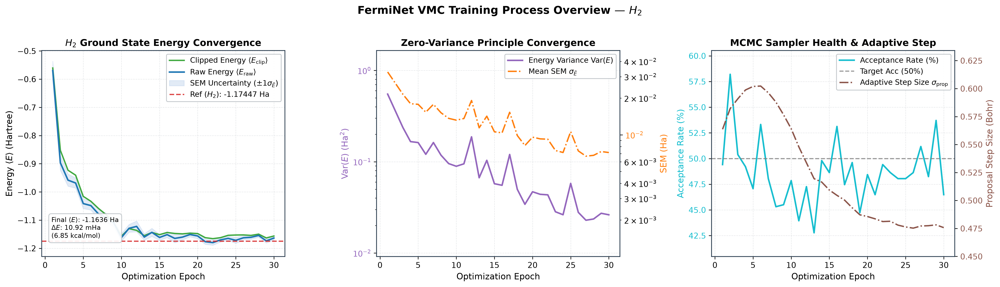
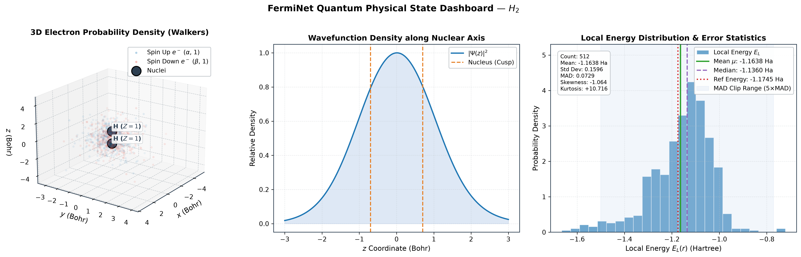
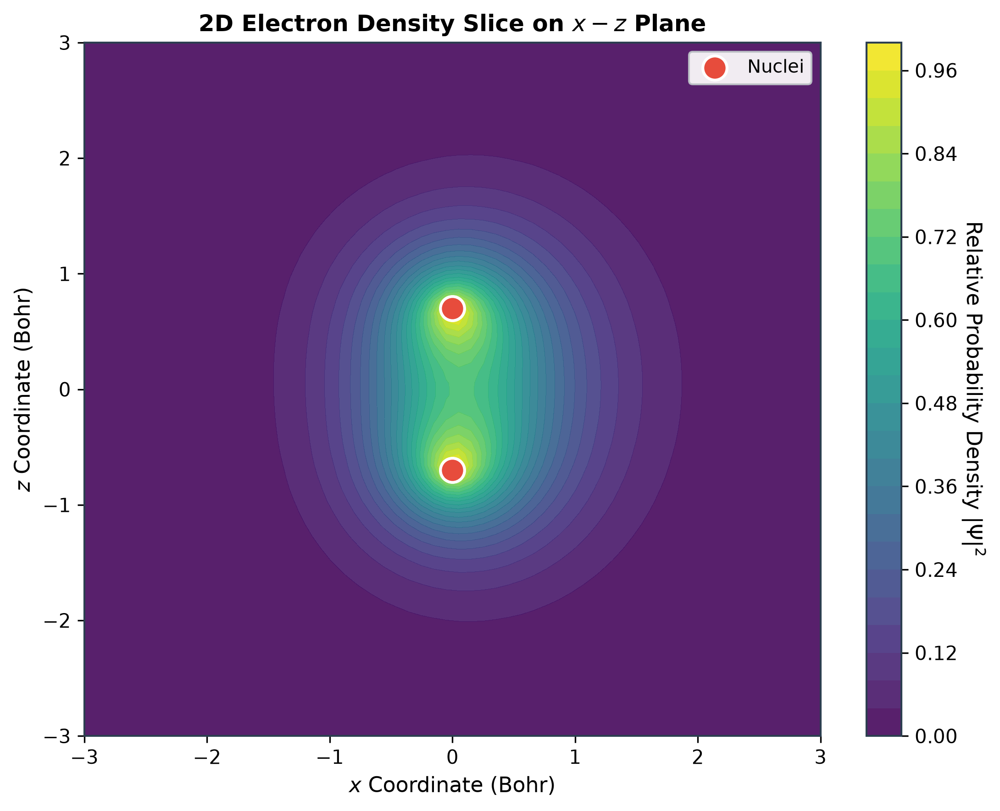

# FermiNet (Fermi Neural Network) PyTorch 研究型实现

[](https://pytorch.org/)
[](https://www.python.org/)
[](LICENSE)
[](#)

本项目提供了一个基于 **PyTorch 原生生态** 的模块化 **FermiNet (费米神经网络)** 研究原型，用于量子化学中多电子薛定谔方程的变分求解、数值实验与算法验证。

> 📖 **参考论文**：  
> **Ab-Initio Solution of the Many-Electron Schrödinger Equation with Deep Neural Networks**  
> *David Pfau, James S. Spencer, Alexander G. de G. Matthews, W. M. C. Foulkes*  
> *Physical Review Research* 2, 033429 (2020) · [DOI: 10.1103/PhysRevResearch.2.033429](https://doi.org/10.1103/PhysRevResearch.2.033429)

<p align="center">
  
</p>

---

## 🔰 初学者导航与入门必读 (Beginner's Guide)

> **没有量子力学或量子化学背景？看不懂波函数、Slater 行列式、变分量子蒙特卡洛？**
> 
> **请直接阅读我们专门打造的零门槛教学宝典：👉 [BEGINNER_GUIDE.md](BEGINNER_GUIDE.md) 👈**
> 
> 在该指南中，我们用**程序员最熟悉的通俗比喻与直白语言**，手把手为你拆解：
> 1. 什么是薛定谔方程与波函数（微观世界的牛顿定律与几率振幅）；
> 2. 泡利不相容原理与费米子反对称性（“撞衫即毁灭”的量子规则）；
> 3. FermiNet 深度学习 Backflow 机制与数据流架构拆解；
> 4. 变分量子蒙特卡洛 (VMC) 随机游走采样与有限批次协方差梯度原理；
> 5. 6 个快速实操演示（含学术风格训练看板与物理态可视化解析）；
> 6. 新手高频问答 FAQ（对数波函数负几百、Hartree 单位制、零方差原理等）。

---

## 🌟 项目核心亮点与技术演进

本项目参考 FermiNet 论文与公开实现，在 PyTorch 生态下实现了若干核心结构和数值实验功能；它是研究原型，不等同于官方实现或论文级复现：

1. **物理结构与数值约束**：
   - 通过 Slater 行列式结构实现同自旋电子交换反对称性；浮点结果仍需按数值容差检查；
   - 使用指数包络约束远场衰减；粒子间距离采用 clamp 软化核 `sqrt(clamp(r², min=eps))`，其中 `eps` 是最小**平方**距离、软化半径为 `sqrt(eps)`（默认 1e-12 Bohr）。该核在 `r² ≥ eps` 处与未软化距离**逐位相同**，故势能偏置精确为零；但波函数 ansatz 本身并不强制 Kato 尖点条件，因此仍不宣称精确 Coulomb cusp；
   - 相对几何特征提取，满足整体平移不变性；当前普通 MLP 特征通路不提供一般 SO(3) 旋转等变保证；
   - 同电荷核共享包络参数（`NuclearEnvelope` 按电荷组参数化），因此**包络部分**在同核置换下严格不变；但**完整波函数不具备核置换不变性**——单电子特征按原子核顺序拼接后送入普通密集层，密集层对核块不对称。以「按距离排序」补上这一项的做法**已被否决**：排序会在电子穿越两同核的垂直平分面时翻转核块顺序，导致波函数在该余维 1 曲面上不连续、∇²ln|Ψ| 失去意义（实测训练能量由 −1.174 退化至 −1.162 并一度跌破变分下界）。要做到既不变又连续必须改为对核做对称聚合，属架构改写。
2. **端到端变分量子蒙特卡洛 (VMC) 训练闭环**：
   - 全向量化批量 GPU 并行 Metropolis-Hastings MCMC 采样器，支持全电子/逐电子步进与自适应步长控制；
   - 默认使用无截断、带 $B/(B-1)$ 有限批次修正的协方差代理梯度，避免三阶导计算；
   - Tanh/Hard 局域能量截断作为显式稳健模式保留；它能抑制离群点，但会引入训练目标偏差；
   - 训练结束后冻结模型和采样步长，报告自相关时间、有效样本数、split-R-hat 与链相关 SEM。
3. **动能拉普拉斯求解器（精确与随机估计）**：
   - 集成 **Hutchinson 随机迹估计器**：探针数与体系规模无关，但探针循环本身是 Python 级，总计算成本、方差与误差仍随体系、网络和 batch 规模变化，不承诺固定倍数加速。单探针估计的重复间标准差可达信号本身的 1.5 倍以上，因此**仅用于训练期方差缩减，禁止用于对外报告能量**——复评路径已强制使用精确求解器；
   - 集成基于 `torch.func.jvp` 的前向模式全向量化精确求解器与经典逐分量精确模式。
4. **PyTorch 2.0+ `torch.compile` JIT 图编译优化**：
   - 提供 TorchDynamo/TorchInductor 编译路径；吞吐收益依赖硬件、batch、精度和算子图，应通过统一基准测量，不预设固定倍数。
5. **超大体系与异核分子支持**：
   - 单电子特征注入原子核电荷 $Z_I$，原生支持极性异核分子（如 $LiH, H_2O$ 等）；
   - 支持 **100 原子超大体系 (H100 晶格链，100 核 + 100 电子)** 的前向可执行性和数值容差测试；这不代表能量精度或训练收敛。
6. **学术风格综合可视化与物理状态看板**：
   - 独立高内聚可视化模块 [`visualize.py`](file:///C:/Users/Administrator/.gemini/antigravity/scratch/ferminet_pytorch/visualize.py)，强制采用无头服务器安全的 `Agg` 后端；
   - 覆盖训练过程动态（能量/方差趋势、MCMC 采样健康度）与物理状态诊断（采样构型、条件切片、局域能量偏度分布）；这些图用于诊断，不自动证明 cusp、电子密度或收敛性；
   - 集成于 CLI（`--plot`, `--save_plots`, `--plot_dir`），支持训练后导出多种 PNG/SVG 图表。

---

## 📂 项目模块全景导览 (Architecture Overview)

<p align="center">
  
</p>

```text
ferminet_pytorch/
├── __init__.py           # 包顶层导出与版本定义
├── features.py           # 相对几何特征提取 (ElectronFeatureEmbedding, 支持 Z_I 注入)
├── layers.py             # 自旋分流相互作用层 (FermiInteractionLayer, 自旋分离均值池化)
├── envelope.py           # 原子核指数衰减包络 (NuclearEnvelope, 各向同性/各向异性度规)
├── model.py              # FermiNet 核心模型 (Backflow 轨道构建与 slogdet / LogSumExp 计算)
├── hamiltonian.py        # 分子哈密顿量 (MolecularSystem, 局域动能与全向量化势能计算)
├── mcmc.py               # 批量并行 GPU MCMC 采样器 (MCMCSampler, 自适应步长控制)
├── mcmc_stats.py         # 链自相关、ESS、split-R-hat 与相关性修正 SEM
├── loss.py               # 有限批次协方差代理损失与可选局域能截断
├── train_vmc.py          # 端到端 VMC 变分优化训练脚本 (支持 H2, LiH 与各拉普拉斯策略)
├── visualize.py          # 综合数据可视化模块（学术风格训练与物理诊断看板）
├── example_h2.py         # 5 分钟上手演示：氢分子单步推断与局域能量拆解
├── benchmark_compile.py  # PyTorch 2.0+ JIT 编译优化加速比评测脚本
├── benchmark_100_atoms.py# 100 原子超大规模体系基准测试与数值容差校验
├── test_ferminet.py      # 核心物理性质与网络架构综合单元测试套件
├── test_vmc.py           # VMC 采样、梯度估计与能量截断专项单元测试
├── test_phase2.py        # 阶段 2 动能求解器、核电荷注入与各向异性包络专项测试
├── test_visualize.py     # 综合可视化模块专项测试套件 (54 项)
├── test_mcmc_stats.py    # 链自相关统计与 AR(1) 解析对照回归测试
├── test_physics_invariants.py # 物理不变量与已知限制回归测试（对称性、尖点、参数可达性、估计器）
├── assets/plots/         # 训练生成的可视化图表资源目录
├── BEGINNER_GUIDE.md     # 零基础小白从零到一量子化学深度学习图文宝典
└── README.md             # 架构技术文档与使用手册
```

### 核心源码文件职责速查

| 源码文件 | 核心职责 | 主要类 / 函数 | 物理/工程特性 |
| :--- | :--- | :--- | :--- |
| [`features.py`](file:///C:/Users/Administrator/.gemini/antigravity/scratch/ferminet_pytorch/features.py) | 几何特征提取 | `ElectronFeatureEmbedding` | 提取相对位移与欧氏距离（clamp 软化核），保证平移不变；不提供一般旋转等变约束；支持注入核电荷 $Z_I$；核轴按电荷组与距离规范化排序，支持同核置换不变 |
| [`layers.py`](file:///C:/Users/Administrator/.gemini/antigravity/scratch/ferminet_pytorch/layers.py) | 自旋分流前馈层 | `FermiInteractionLayer` | 单/双流信息融合，自旋向上与向下分别池化聚合，满足同自旋置换等变性；末层双电子流输出不被下游消费，故不再构造其更新网络（消除空转参数） |
| [`envelope.py`](file:///C:/Users/Administrator/.gemini/antigravity/scratch/ferminet_pytorch/envelope.py) | 指数衰减基底 | `NuclearEnvelope` | 约束 $r \to \infty$ 时波函数趋零；支持可学习各向异性三维主轴度规 $\Sigma$ |
| [`model.py`](file:///C:/Users/Administrator/.gemini/antigravity/scratch/ferminet_pytorch/model.py) | 主干波函数网络 | `FermiNet` | 构造 Backflow 轨道，多行列式 `slogdet` 分解与 LogSumExp 稳定求和 |
| [`hamiltonian.py`](file:///C:/Users/Administrator/.gemini/antigravity/scratch/ferminet_pytorch/hamiltonian.py) | 哈密顿量与动能 | `MolecularSystem`, `compute_local_energy` | 库仑吸引/排斥势能全向量化计算；集成 Exact, JVP, Hutchinson 三大拉普拉斯求解器 |
| [`mcmc.py`](file:///C:/Users/Administrator/.gemini/antigravity/scratch/ferminet_pytorch/mcmc.py) | 并行构型采样 | `MCMCSampler` | 批量并行 Metropolis-Hastings 抽样，波函数对数缓存，自适应步长微调 |
| [`loss.py`](file:///C:/Users/Administrator/.gemini/antigravity/scratch/ferminet_pytorch/loss.py) | 变分代理损失 | `VMCLoss`, `vmc_surrogate_loss` | 默认无截断有限批次协方差修正；MAD 截断为显式稳健有偏模式 |
| [`train_vmc.py`](file:///C:/Users/Administrator/.gemini/antigravity/scratch/ferminet_pytorch/train_vmc.py) | 端到端训练优化 | `train_vmc` | 训练后冻结参数独立复评，报告 ESS、自相关时间、R-hat 与链相关 SEM |
| [`visualize.py`](file:///C:/Users/Administrator/.gemini/antigravity/scratch/ferminet_pytorch/visualize.py) | 综合可视化分析 | `plot_training_dashboard`, `plot_all_visualizations` 等 10+ 绘图函数 | 学术风格绘图工具、无 GUI 隔离后端、训练/采样及条件切片诊断 |

参考能量只在核电荷、自旋电子数和核间几何与登记记录全部匹配时显示。相同核数和电子数不会被用于猜测分子身份；未知体系不绘制参考线。

---

## 📐 张量维度规范 (Tensor Shape Specification)

为保障多卡 GPU 上的并行效率与维度一致性，全模块严格遵循以下张量规范：

| 张量名称 | 数学符号 | 形状 (Shape) | 物理含义与说明 |
| :--- | :--- | :--- | :--- |
| `r` | $r$ | `(B, N, 3)` | $B$ 个 MCMC Walkers，每个构型包含 $N$ 个电子的 3 维笛卡尔坐标 |
| `nuclear_coords` | $R$ | `(M, 3)` | $M$ 个原子核的固定三维坐标 (Bohr) |
| `nuclear_charges` | $Z$ | `(M,)` | $M$ 个原子核的核电荷量 (原子序数) |
| `h1` | $h_i^l$ | `(B, N, d_1)` | 第 $l$ 层的单电子流隐藏特征 ($d_1$ 默认 64) |
| `h2` | $h_{ij}^l$ | `(B, N, N, d_2)` | 第 $l$ 层的双电子流隐藏特征 ($d_2$ 默认 16) |
| `D_up` | $D_k^\uparrow$ | `(B, K, n_up, n_up)` | 自旋向上电子的分子轨道矩阵 ($K$ 为行列式分支数) |
| `D_down` | $D_k^\downarrow$ | `(B, K, n_down, n_down)` | 自旋向下电子的分子轨道矩阵 |
| `log_abs_psi` | $\ln\|\Psi(r)\|$ | `(B,)` | 波函数的对数绝对值（保障数值防下溢） |
| `sign_psi` | $\text{sign}(\Psi)$ | `(B,)` | 波函数符号值（$-1, 0, 1$） |
| `e_local` | $E_L(r)$ | `(B,)` | 各采样构型处的局域能量标量（单位：Hartree） |

---

## ⚡ 5 分钟极速上手实操 (5-Minute Quickstart)

### 演示 1：氢分子 $H_2$ 基础波函数推断与局域能量计算

单步实例化模型并计算对数波函数 $\ln|\Psi(r)|$ 与局域能量 $E_L(r) = T_L(r) + V(r)$：

```bash
# 在项目根目录下直接运行：
python example_h2.py
# 或使用 uv 运行：
uv run python example_h2.py
```

**Python 核心调用代码**：
```python
import torch
try:
    from ferminet_pytorch import FermiNet, MolecularSystem, compute_local_energy
except ImportError:
    from model import FermiNet
    from hamiltonian import MolecularSystem, compute_local_energy

# 1. 定义氢分子 H2 物理体系 (2 核, 2 电子: 1 up, 1 down, 键长 1.4 a.u.)
nuclear_coords = torch.tensor([[0.0, 0.0, -0.7], [0.0, 0.0, 0.7]], dtype=torch.float32)
nuclear_charges = torch.tensor([1.0, 1.0], dtype=torch.float32)
system = MolecularSystem(nuclear_coords, nuclear_charges, n_up=1, n_down=1)

# 2. 实例化 FermiNet
model = FermiNet(nuclear_coords, nuclear_charges, n_up=1, n_down=1, num_determinants=16)

# 3. 构造 4 个采样构型并前向推断波函数
r = torch.randn(4, 2, 3, requires_grad=True)
log_abs_psi, sign_psi = model.forward_log_psi(r)

# 4. 计算局域能量 (动能 + 势能)
e_local, t_local, v_local = compute_local_energy(model, system, r)
print("局部动能 T_L:", t_local)
print("局部势能   V:", v_local)
print("总局域能量 E_L:", e_local)
```

---

### 演示 2：氢分子 $H_2$ 端到端 VMC 变分训练

使用变分量子蒙特卡洛算法，通过 Adam 优化器优化登记的 H₂ 体系；训练结果可与匹配电荷、自旋和几何的参考值比较，但短训练不保证逼近真实基态（参考值约为 $-1.1744$ Hartree，适用于登记的 1.4 Bohr 几何和相应 Hamiltonian）：

```bash
# 启动 50 轮训练，配备 1024 个并行 Walkers
python train_vmc.py --epochs 50 --walkers 1024 --lr 1e-3
# 或使用 uv 运行：
uv run python train_vmc.py --epochs 50 --walkers 1024 --lr 1e-3
```

**训练输出指标通俗解读**：
- `<E_raw>` (原始局域能均值)：示例 H₂ 运行中可能下降到约 $-1.17$ Ha；实际轨迹取决于几何、随机种子、采样和 Laplacian 方法；
- `Var(E)` (能量方差)：零方差原理提供有用诊断，但有限样本下会波动，低方差本身不能单独证明已收敛到基态；
- `Acc (%)` (接受率)：采样器使用约 $50\%$ 的工程目标进行步长适应；最优接受率取决于提议分布和体系维度。

#### 科研结果的统计口径

训练期的 `<E_raw>`、`Var(E)` 与 `IID SEM*` 只用于优化诊断：连续 MCMC 样本相关，`IID SEM*` 不是最终误差条。训练结束后，`train_vmc` 会冻结模型参数与采样步长，重新平衡并默认采集 `32 × num_walkers` 个精确局域能量样本。

返回字典中的 `final_energy` 和 `final_variance` 来自该独立复评；`training_last_batch_energy` 单独保留，避免把更新前批次与最终模型混淆。`evaluation` 包含：

- `energy_sem`：按有效样本数修正的链相关标准误；
- `ess` 与 `tau_int`：有效样本数和积分自相关时间；
- `r_hat`：split-R-hat 链间收敛诊断；
- `laplacian_method`：复评使用的局域能量算法。

`r_hat` 接近 1 且 ESS 足够大，才说明该次复评的误差条具有参考价值；短训练的能量下降本身不构成论文精度声明。可按预算调整复评：

```bash
python train_vmc.py --epochs 50 --walkers 256 \
  --evaluation_steps 64 --evaluation_mcmc_steps 5 \
  --evaluation_burn_in 40 --evaluation_laplacian_method exact
```

H₂ 参考线只在核电荷 `[1, 1]`、自旋 `(1, 1)`、核间距 `1.4 Bohr` 都匹配时显示；LiH 同样要求登记的电荷、自旋与 `3.015 Bohr` 几何。未匹配体系不猜测参考能量。

---

### 演示 3：极性异核分子氢化锂 $LiH$ 变分优化

氢化锂 $LiH$ 是具有非对称电荷分布的经典分子（$Z_{\text{Li}} = 3, Z_{\text{H}} = 1$，4 电子）。
结合核电荷注入几何特征与 Hutchinson 随机迹估计器，可在特定硬件和误差容忍度下减少单步导数开销；实际收益需按统一基准测量。

> ⚠️ `--laplacian_method hutchinson` **仅作用于训练期**。最终报告的能量走独立复评路径，强制使用精确求解器（`exact`）；`--evaluation_laplacian_method` 不接受 `hutchinson`。原因见上文：单探针随机迹估计的标准差可达信号本身的 1.5 倍以上。

```bash
python train_vmc.py --system lih --laplacian_method hutchinson --epochs 30 --walkers 512
# 或使用 uv 运行：
uv run python train_vmc.py --system lih --laplacian_method hutchinson --epochs 30 --walkers 512
```
只有在登记的 LiH 电荷、自旋和 `3.015 Bohr` 几何完全匹配时，才会显示 $\approx -8.070$ Hartree 的参考线。短训练仅用于验证链路与趋势，不能据此宣称已经收敛。

---

### 演示 4：100 原子超大规模体系与物理基准测试

体验 100 个氢原子组成的一维强关联晶格链（$M=100, N=100$，输入维度高达 300 维）：

```bash
# 建议添加 --double 双精度参数（进行 100 电子数值容差测试）
python benchmark_100_atoms.py --double
# 或快速模式 (跳过 300 维耗时二阶拉普拉斯求解)：
python benchmark_100_atoms.py --double --quick
```
**实测特性**：
- 在给定数值容差内检查 100 电子置换反对称性：轨道矩阵和对数幅值误差取决于 dtype、条件数与测试阈值；
- 同自旋电子重合时，反对称结构在精确算术下要求波函数为零；浮点实现以小幅值/对数幅值阈值进行数值检查，不宣称机器精确归零；
- 全向量化计算势能，单次批量计算数万构型仅需数毫秒。

---

### 演示 5：PyTorch 2.0+ 编译优化加速评测

通过 `torch.compile` 对 FermiNet 进行 JIT 算子融合与计算图优化：

```bash
python benchmark_compile.py
# 或使用 uv 运行：
uv run python benchmark_compile.py
```

脚本会报告 Eager 与编译模式的稳态延迟、吞吐、首次编译成本和数值差异。结果必须连同 GPU、PyTorch/CUDA 版本、dtype、batch、同步方式和误差定义一起记录；不同环境之间不能直接比较，也不能从一次运行推导固定加速倍数或机器精度结论。

---

### 演示 6：一键全自动生成训练过程与物理状态综合可视化看板

在执行 VMC 变分优化时，只需添加 `--save_plots`（或 `--plot`），训练结束后将自动调用 [`visualize.py`](file:///C:/Users/Administrator/.gemini/antigravity/scratch/ferminet_pytorch/visualize.py) 导出多种学术风格诊断图表到指定目录：

```bash
# 启动 30 轮 VMC 优化并自动导出图表至 assets/plots 目录
python train_vmc.py --system h2 --epochs 30 --walkers 512 --save_plots --plot_dir assets/plots
```

#### 1. 训练全景综合看板 (`h2_training_dashboard.png`)
直观涵盖能量和方差趋势（作为零方差诊断）、以及 MCMC 采样接受率/自适应步长健康度：
<p align="center">
  
</p>

#### 2. 量子物理状态综合看板 (`h2_physical_dashboard.png`)
展示采样或固定构型下的条件切片、沿核轴的一维波函数剖面（不作为精确 Kato cusp 证明），以及局域能量分布直方图与偏度分析：
<p align="center">
  
</p>

#### 3. 2D 固定构型下的波函数条件切片热力图 (`h2_wavefunction_2d.png`)
用于观察固定其余电子构型时的空间条件切片；它不是经过边缘化和归一化的一体电子密度：
<p align="center">
  
</p>

---

## 🧪 单元测试套件 (Unit Tests)

本项目包含 5 套覆盖核心物理性质、VMC 训练、链相关统计、阶段 2 求解器以及综合可视化的自动化测试：

```bash
# 1. 一键运行全部 134 项单元测试：
python -m unittest discover -s . -p "test_*.py" -v

# 2. 或分别运行专项测试：
python -m unittest test_ferminet.py   # 核心物理性质与网络架构测试 (14 项)
python -m unittest test_vmc.py        # VMC 采样、代理损失与能量截断测试 (18 项)
python -m unittest test_phase2.py     # 阶段 2 动能求解器与物理特征测试 (23 项)
python -m unittest test_visualize.py  # 综合可视化分析模块专项测试 (54 项)
python -m unittest test_mcmc_stats.py # ESS、链相关 SEM 与 split-R-hat 测试 (4 项)
```
当前基线为 **134 项测试通过**。测试覆盖实现性质与数值回归，但不能替代长时间、多种子、独立复评的科学收敛验证。

---

## ❓ 常见问题速查 (FAQ Snapshot)

- **Q: 为什么计算出的波函数对数值 `log|Psi|` 经常是负几百？**  
  A: 这是完全正常的！多电子联合概率密度是高维微元几率的连乘，真实验证波函数振幅极小（例如 $10^{-100}$）。取自然对数后落入负几百区间，有效防止单精度下溢为零。
- **Q: 什么是 Hartree 原子单位制？**  
  A: 在量子化学中令 $\hbar = m_e = e = 1$。能量单位 $1 \text{ Hartree} \approx 27.2114 \text{ eV} \approx 627.51 \text{ kcal/mol}$；长度单位 $1 \text{ Bohr} \approx 0.529177 \text{ \AA}$。
- **Q: 为什么训练时要观察能量方差 `Var(E)`？**
  A: 零方差原理说明：若试探波函数正好是 Hamiltonian 的本征态，局域能量在非节点处为常数，理论方差为零。实际训练中它只是辅助诊断，不能单独证明基态收敛。

> 更多深度原理解读与详尽问答，请参阅专著指南：[BEGINNER_GUIDE.md](BEGINNER_GUIDE.md)

---

## 📜 许可证 (License)

本项目遵循 [MIT License](LICENSE) 开源协议。
